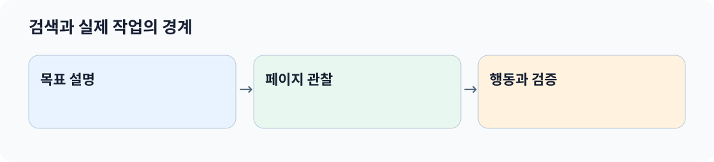

# 01. AI 브라우저란 무엇인가

AI 브라우저는 단순히 웹페이지 안에 채팅창이 붙은 브라우저가 아닙니다. 사용자가 목표를 말하면 AI가 웹페이지를 관찰하고, 다음 행동을 선택하고, 브라우저에 그 행동을 전달하고, 결과를 다시 확인하는 시스템입니다.

*그림: 이 장의 설명을 요약한 저자 제작 도식입니다. 실제 제품 화면이 아닙니다.*

## 검색창과 에이전트의 차이

| 구분 | 일반 검색 | AI 브라우저 에이전트 |
|---|---|---|
| 사용자의 요청 | 검색어 | 목표와 조건 |
| 주요 행동 | 결과 목록 표시 | 페이지 이동·입력·클릭·비교 |
| 결과 | 링크와 요약 | 파일·작성 결과·완료 화면 |
| 실패 처리 | 사용자가 다시 검색 | 에이전트가 재시도하거나 중단 |
| 위험 | 잘못된 정보 | 잘못된 클릭·전송·권한 사용 |

예를 들어 “서울에서 다음 주말에 갈 만한 전시를 찾아줘”는 검색으로도 가능합니다. 그러나 “조건에 맞는 전시 세 곳을 비교표로 만들고, 내가 고른 곳의 예약 페이지까지 열어줘”부터는 여러 페이지를 오가고 조건을 기억해야 하므로 에이전트 작업에 가까워집니다.

## 핵심은 ‘브라우저를 가진 모델’이 아니다

언어 모델만으로는 화면의 버튼을 누를 수 없습니다. 모델의 판단을 실제 브라우저 동작으로 바꾸는 실행 계층이 필요합니다. 이 계층에는 브라우저 연결, 화면 관찰, 입력 전송, 대기, 오류 처리, 권한 확인이 포함됩니다.

이를 자동차에 비유하면 언어 모델은 운전 계획을 말하는 사람이고, 브라우저 하네스는 핸들·브레이크·센서·안전벨트를 연결한 장치입니다. 계획이 좋아도 실행 계층이 잘못 연결되면 엉뚱한 페이지에서 행동할 수 있습니다.

## 인기의 의미

2026년 11월 2일에 다시 확인한 [Browser Use](https://github.com/browser-use/browser-use)와 [Browser Harness](https://github.com/browser-use/browser-harness)의 공개 저장소에는 많은 관심이 모여 있습니다. 스타 수는 계속 바뀌므로 이 책에서는 순위나 품질의 증거로 사용하지 않습니다. 실제 사용 전에는 지원 브라우저·권한·로그인 방식·실패 사례를 따로 확인해야 합니다.

다음 장부터는 “AI가 똑똑한가”보다 “무엇을 보고 어떤 행동을 선택하며 결과를 어떻게 검증하는가”를 중심으로 살펴봅니다.

## 첫 요청을 두 문장으로 바꾸기

“전시를 찾아줘”에 **조건**과 **마지막 행동**을 덧붙이면 역할이 분명해집니다. 예를 들어 “토요일 오후, 서울 시내, 2만 원 이하 전시 세 곳을 비교해 줘. 예약 페이지는 열어도 신청·결제는 하지 마.”라고 요청할 수 있습니다.

결과를 받을 때는 전시 이름만 읽지 말고 원문 주소, 날짜, 가격 기준을 함께 확인하세요. 에이전트가 페이지를 열었다는 기록은 탐색의 증거이고, 비교표가 맞는지는 원문 대조로 확인해야 합니다.
