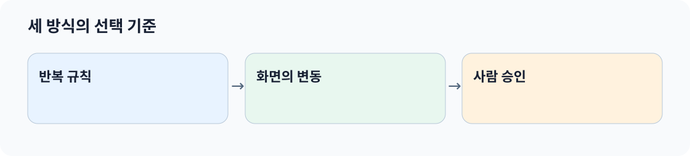

# 02. 챗봇·자동화·에이전트의 차이

비슷해 보이는 세 용어를 먼저 분리해야 합니다.

| 이름 | 사람이 정하는 것 | 시스템이 정하는 것 | 예시 |
|---|---|---|---|
| 챗봇 | 질문과 대화 흐름 | 다음 문장 | 일정에 대해 답하기 |
| 자동화 | 순서와 조건을 미리 지정 | 정해진 순서 실행 | 매일 같은 양식 내려받기 |
| 에이전트 | 목표·제약·승인 범위 | 관찰에 따른 다음 행동 | 페이지 구조가 달라도 예약 흐름 찾기 |

여기서 “시스템이 정한다”는 말은 **허용 범위 안에서** 다음 행동을 고른다는 뜻입니다. 에이전트가 목적을 이해했다고 해서 계정 변경이나 결제를 승인받은 것은 아닙니다. 계획을 세우는 모델, 행동을 실행하는 도구, 승인하는 사람이 각각 다른 역할을 맡습니다.

자동화는 미리 그려 둔 기차 노선과 같습니다. 에이전트는 목적지만 정하고 도중의 길을 선택하는 택시와 비슷합니다. 유연한 대신, 잘못된 길을 선택할 가능성도 커집니다.

*그림: 반복 규칙, 화면 변화, 사람 승인이 필요한 정도로 작업 방식을 고르는 기준입니다. 저자 제작 도식이며 실제 제품 화면이 아닙니다.*

## 에이전트가 어려운 이유

웹페이지는 항상 같은 모양이 아닙니다. 버튼의 위치가 바뀌고, 광고가 끼어들고, 로그인 세션이 만료되고, 페이지 안의 문장이 AI에게 행동을 지시하려 할 수 있습니다. 따라서 에이전트는 매 단계에서 다음을 판단해야 합니다.

1. 지금 어느 사이트·페이지에 있는가
2. 목표와 관련된 요소는 무엇인가
3. 다음 행동이 읽기인가 실행인가
4. 실행해도 되는 권한인가
5. 행동 뒤 결과가 목표를 만족했는가

이 다섯 질문이 책 전체의 공통 점검표입니다.

## 업무를 작은 단계로 쪼개기

“항공권을 예약해 줘”는 너무 넓습니다. 다음처럼 읽기와 실행을 나눠야 합니다.

| 단계 | 허용 범위 | 사람 확인 |
|---|---|---|
| 조건 검색 | 공개 정보 읽기 | 보통 불필요 |
| 후보 비교 | 가격·시간 표 만들기 | 결과 확인 |
| 승객 정보 입력 | 개인정보 사용 | 필요 |
| 결제 버튼 누르기 | 금전 거래 | 반드시 필요 |

AI 브라우저를 잘 사용하는 사람은 AI에게 일을 많이 시키는 사람이 아니라, 위험이 커지는 지점을 정확히 나누는 사람입니다.

## 어떤 방식으로 시작할까

| 업무 모습 | 먼저 고려할 방식 | 이유 |
| --- | --- | --- |
| 매일 같은 공개 파일 받기 | 정해진 자동화 | 순서와 결과가 일정함 |
| 여러 사이트에서 조건 비교 | 에이전트 | 탐색 경로가 바뀔 수 있음 |
| 고객에게 확정 메일 발송 | 초안 + 사람 승인 | 수신자와 약속을 확인해야 함 |

에이전트가 유연하다는 이유만으로 모든 업무에 쓰지 않습니다. 정해진 규칙으로 충분한 업무는 명시적인 자동화가 더 검토하기 쉽습니다. 어떤 방식을 택하든 성공 상태와 멈춤 조건은 문장으로 남겨야 합니다.

## 한 업무 안에서도 방식을 섞을 수 있습니다

전시 후보를 찾는 단계는 에이전트에게 맡기고, 정해진 양식으로 비교표를 만드는 단계는 고정된 자동화로 처리할 수 있습니다. 마지막 예약은 사람이 확인합니다. 업무 전체를 한 도구에 넘기기보다, **탐색이 필요한 단계와 규칙이 정해진 단계**를 나누면 결과를 더 쉽게 검증할 수 있습니다. 이는 도구의 기능을 섞는 설계 예시이며, 특정 서비스가 이 세 단계를 자동으로 제공한다는 뜻은 아닙니다.
