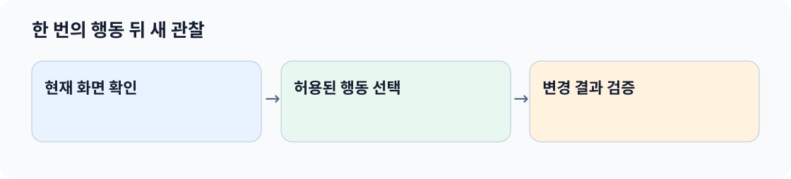

# 04. AI는 다음 행동을 어떻게 고르는가

브라우저 에이전트는 보통 다음 루프를 반복합니다. 다만 한 번의 모델 응답에 클릭과 입력처럼 여러 행동이 묶여 나올 수 있습니다. 따라서 실행기는 각 행동을 실행하기 전에 허용 범위와 정책을 확인해야 합니다. 외부 전송이나 결제처럼 중요한 행동에는 별도로 사람의 승인을 받습니다. 모든 클릭마다 사람에게 묻는다는 뜻은 아닙니다. [OpenAI](https://developers.openai.com/api/docs/guides/tools-computer-use)와 [Anthropic](https://platform.claude.com/docs/en/agents-and-tools/tool-use/computer-use-tool)의 컴퓨터 사용 문서가 이 실행 구조를 설명합니다(2026-11-27 확인).

```text
목표와 제약 확인
      ↓
현재 화면 관찰
      ↓
가능한 다음 행동 선택
      ↓
행동 전 권한·위험 확인
      ↓
클릭·입력·이동·대기
      ↓
결과 관찰과 성공 검증
      └── 실패하면 재시도·중단·사람에게 질문
```



*그림: 현재 화면을 읽고 허용된 행동을 고른 뒤 바뀐 결과를 다시 확인하는 한 번의 실행 루프입니다. 저자 제작 도식이며 실제 제품 화면이 아닙니다.*

## 계획보다 관찰이 중요한 이유

웹페이지는 계획을 세운 뒤에도 바뀝니다. 검색 결과가 늦게 도착하거나, 팝업이 나타나거나, 로그인 세션이 끝날 수 있습니다. 따라서 “세 번째 버튼을 누른다” 같은 위치 기반 계획보다 “행사 A 설명 아래의 신청 양식을 찾는다”처럼 의미를 기준으로 행동해야 합니다.

## 공개 행사 A 신청 양식의 일곱 번 판단

다음은 3장에서 소개한 **가상 교육용 양식**을 이어 보는 추적표입니다. 실제 사이트에서 실행하거나 신청서를 제출한 기록은 아닙니다. 목표는 행사 조건을 확인하고 제출 전 승인을 받는 것입니다.

| 순서 | 지금 관찰할 것 | 가능한 다음 행동 | 넘어가기 전에 필요한 증거 |
| --- | --- | --- | --- |
| 1. 접속 | 주소와 행사 주최자 | 허용된 공식 주소만 열기 | URL과 페이지 제목이 요청과 일치 |
| 2. 조건 확인 | 날짜·장소·비용·마감 | 스크롤하고 설명 읽기 | 네 조건을 원문 위치와 함께 기록 |
| 3. 양식 찾기 | 이름·이메일 칸과 필수 표시 | 입력칸을 선택 | 라벨과 현재 화면의 대응 확인 |
| 4. 입력 | 사용자가 제공한 값과 현재 입력값 | 허용된 칸에만 값 입력 | 입력 후 화면에서 값과 대상 칸 재확인 |
| 5. 약관·동의 | 체크박스 문구와 제출 버튼 | 내용을 사용자에게 보여 주고 멈춤 | 동의 범위·전송 대상·입력값을 사용자가 확인 |
| 6. 제출 | 명시적 승인 여부 | 승인된 경우에만 한 번 제출 | 행동 실행 기록과 새 화면 확보 |
| 7. 완료 확인 | 접수번호·확인 화면·메일 등 | 증거 저장 또는 미확인 보고 | 신청이 실제 접수됐다는 독립적인 표시 |

표의 6단계는 사용자의 승인 없이는 실행하지 않습니다. 7단계의 확인 화면은 사이트에 따라 다를 수 있으므로, 접수번호가 없으면 실제 제공된 다른 확인 수단을 찾습니다. 반대로 입력을 끝냈다는 사실이나 버튼을 눌렀다는 기록만으로는 접수 완료라고 말하지 않습니다. [OpenAI Computer Use](https://developers.openai.com/api/docs/guides/tools-computer-use)는 모델의 행동 요청을 실행기가 수행하고 새 화면을 반환하는 순서를 설명합니다.

오류가 나면 **마지막으로 확인된 상태**로 돌아갑니다. 주소가 바뀌었으면 1단계부터 다시 확인하고, 입력값이 사라졌다면 같은 개인정보를 다시 넣어도 되는지 판단합니다. 제출 직후 화면이 멈췄다면 버튼을 다시 누르기 전에 접수 내역을 확인합니다. 확인 수단이 없으면 ‘완료 여부 미확인’으로 기록해 사람에게 넘깁니다.

## 행동의 위험 등급

| 등급 | 행동 | 기본 정책 |
|---|---|---|
| 낮음 | 공개 페이지 읽기·스크롤 | 자동 진행 가능 |
| 중간 | 검색어 입력·파일 다운로드 | 범위와 저장 위치 확인 |
| 높음 | 메시지 전송·파일 업로드·계정 변경 | 실행 전 승인 |
| 매우 높음 | 결제·삭제·계약 동의 | 사람이 직접 마지막 행동 |

위험 등급은 서비스와 상황에 따라 달라집니다. 같은 “클릭”이라도 공개 문서의 다음 페이지 버튼과 결제 버튼은 전혀 다른 행동입니다.

## 멈춤 조건을 먼저 정하기

좋은 요청에는 성공 조건과 멈춤 조건이 함께 들어갑니다.

> 공개 행사 A의 일정·장소·참가비를 확인하고 신청 양식에 내가 준 정보만 입력해 줘. 개인정보 동의나 `신청하기` 버튼 앞에서는 멈추고, 페이지 주소와 입력값을 보여 줘.

이렇게 말하면 에이전트가 목표를 향해 움직이되, 사용자가 예상하지 않은 외부 행동은 하지 않게 됩니다.

## 다음 단계로 넘어가는 문턱

에이전트가 “이메일을 입력했다”고 보고해도 해당 칸의 값이 바뀌었는지 확인하기 전에는 다음 단계로 넘어가면 안 됩니다. 화면이 바뀌지 않았다면 잘못된 칸을 선택했거나, 입력이 차단됐거나, 로딩이 진행 중일 수 있습니다. 모델이 행동 요청 생성을 끝냈다는 표시 역시 실제 화면에서 행동이 성공했다는 증거가 아닙니다.

| 확인 결과 | 다음 행동 |
| --- | --- |
| 예상한 결과가 나타남 | 다음 단계 진행 |
| 로딩 중 | 잠시 기다리고 다시 관찰 |
| 다른 페이지로 이동 | URL·계정·목표 재확인 |
| 승인 화면 등장 | 조건을 보여 주고 사람에게 질문 |

관찰과 행동을 반복하는 구조는 [Browser Use의 공개 프로젝트](https://github.com/browser-use/browser-use)가 설명하는 에이전트 동작을 업무용 점검 절차로 풀어쓴 것입니다.

## 재시도 전에 외부 상태부터 봅니다

페이지가 멈춘 것처럼 보여도 신청이나 전송이 이미 끝났을 수 있습니다. 같은 버튼을 다시 누르면 예약이 중복될 수 있으므로, **결과 목록·확인 번호·전송 내역**을 먼저 확인합니다. 확인할 수 없다면 무작정 반복하지 않고 사람에게 현재 화면과 마지막 시도를 전달합니다. [Microsoft Foundry 문서](https://learn.microsoft.com/en-us/azure/foundry/agents/how-to/tools/browser-automation)는 타임아웃 뒤 재시도하기 전 실제 애플리케이션 상태를 확인하라고 명시합니다.
