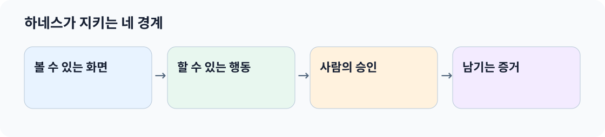

# 05. 브라우저 하네스와 실행 환경

브라우저 하네스는 AI의 판단을 실제 브라우저 행동으로 연결하는 실행 장치입니다. 언어 모델 자체가 브라우저를 조작하는 것이 아니라, 하네스가 모델의 행동 요청을 클릭·입력·스크롤·탭 전환 같은 명령으로 바꿉니다.

구현에 따라 하네스는 사용자의 기존 브라우저, 격리된 가상 브라우저, 기업이 관리하는 원격 브라우저 가운데 하나에 연결됩니다. 어느 방식이든 **모델에 보여 주는 화면**과 **실제로 사용할 계정·파일·네트워크**의 경계를 먼저 정해야 합니다. [OpenAI의 ChatGPT Work 클라우드 브라우저](https://help.openai.com/en/articles/20001280-using-cloud-browser-in-chatgpt)는 사용자 기기의 기존 쿠키·탭과 분리된 세션을 사용하고, [Microsoft Foundry](https://learn.microsoft.com/en-us/azure/foundry/agents/how-to/tools/browser-automation)는 관리형 원격 브라우저를 제공합니다(2026-11-27 확인).

*그림: 에이전트가 볼 수 있는 화면, 수행할 행동, 사람의 승인, 남길 증거라는 네 경계를 나타냅니다. 저자 제작 도식이며 실제 제품 화면이 아닙니다.*

## 하네스의 구성

| 구성 | 하는 일 | 고장 나면 보이는 현상 |
|---|---|---|
| 브라우저 연결 | Chrome 등 세션에 연결 | 다른 창을 조작하거나 연결 실패 |
| 관찰기 | DOM·접근성 트리·스크린샷 제공 | 요소를 찾지 못함 |
| 행동기 | 클릭·입력·스크롤·대기 | 명령이 화면에 반영되지 않음 |
| 세션 관리자 | 쿠키·탭·로그인 상태 관리 | 로그인 풀림·잘못된 계정 |
| 권한 게이트 | 위험 행동을 멈추고 승인 요청 | 원치 않는 전송·변경 |
| 검증기 | 결과 화면·파일·로그 확인 | 클릭만 하고 성공으로 오판 |

이 표는 제품 공통의 **설계 역할**을 설명합니다. 특정 서비스에 표의 모든 부품이 독립 기능으로 존재한다는 뜻은 아닙니다. 실제 서비스 설명에서는 어떤 부품이 제공되고 무엇을 사용자가 직접 구현해야 하는지 나눠 확인해야 합니다.

## 가상 행사 신청 업무를 하네스에 넣으면

3~4장의 **‘공개 행사 A 신청 양식’은 교육용 예시**입니다. 실제 사이트의 기능이나 실행 결과가 아닙니다. “조건을 읽고, 제공받은 정보만 입력하고, 제출 전 멈춘다”는 목표를 아래처럼 나누면 하네스의 역할이 보입니다.

| 하네스 단계 | 이 업무에서 지킬 규칙 | 다음 단계에 넘길 기록 |
| --- | --- | --- |
| 실행 환경 | 허용한 행사 사이트만 열고 별도 세션 사용 | 세션 식별자와 시작 URL |
| 관찰기 | 행사명·날짜·입력칸 라벨·현재 값을 읽기 | 관찰 시각과 페이지 주소 |
| 정책 검사 | 허용된 공개 읽기와 입력만 통과; 다른 도메인·파일 업로드는 중단 | 허용 또는 거부 이유 |
| 행동 실행기 | 허용된 칸에 제공된 값만 입력하고 새 화면 확보 | 요청한 행동, 실행 결과, 새 화면 상태 |
| 승인 문턱 | `신청하기` 전에 전송 대상·입력값·동의 문구를 사람에게 제시 | 누가 어떤 범위를 승인했는지 |
| 완료·복구 | 제출 뒤 접수 증거 확인; 모호한 타임아웃이면 중복 제출 중단 | 확인 화면 또는 ‘완료 여부 미확인’ |

모델이 “제출하라”고 요청해도 정책 검사를 통과하지 못하면 실행기는 버튼을 누르지 않아야 합니다. 승인 화면에는 최소한 **어느 사이트에, 누구의 어떤 정보가, 어떤 동의와 함께 전송되는지**가 보여야 합니다. 승인이 없으면 양식은 작성된 상태로 멈추고, 승인 후에도 접수 결과를 다시 확인합니다. [Anthropic의 Browser Use 보안 안내](https://platform.claude.com/docs/en/agents-and-tools/tool-use/browser-use-tool)는 허용 도메인과 중요한 행동의 사람 확인을 실행기에서 검사하도록 설명합니다. [OpenAI 클라우드 브라우저 도움말](https://help.openai.com/en/articles/20001280-using-cloud-browser-in-chatgpt)도 사이트 접근 허가와 실제 중요한 행동의 승인을 별도로 둡니다.

로그는 “성공”이라는 한 단어보다 **행동 전 URL → 요청한 행동 → 실행 여부 → 행동 후 화면 → 승인·확인 증거**를 이어 주어야 합니다. 비밀번호·보안 코드 같은 값은 로그에 그대로 남기지 않습니다. 화면 캡처와 실행 기록에도 개인정보가 들어갈 수 있으므로 접근 권한과 보관 범위를 정합니다. [Microsoft Foundry 문서](https://learn.microsoft.com/en-us/azure/foundry/agents/how-to/tools/browser-automation)는 세션 기록과 추적 데이터가 민감정보를 포함할 수 있음을 경고합니다.

## 브라우저 자동화와의 차이

전통적인 자동화는 “이 위치의 버튼을 누르고 이 입력창에 값을 넣어라”를 사람이 미리 작성합니다. 하네스는 AI가 현재 화면을 보고 다음 행동을 고를 수 있도록 관찰과 실행을 묶습니다. 그래서 유연하지만 예측 가능성과 안전성은 더 어려운 문제가 됩니다.

## 실제 Chrome을 연결할 때의 주의점

로그인된 브라우저를 AI에게 연결하면 AI가 그 계정의 권한을 사용할 수 있습니다. 따라서 테스트 전용 계정, 제한된 프로필, 별도 브라우저 창을 사용합니다. 개인 메일·결제수단·비밀번호가 있는 기본 프로필을 바로 연결하지 않습니다. 클라우드 브라우저는 개인 브라우저와 분리될 수 있지만 로그인 후에는 그 클라우드 세션 자체가 계정 권한을 갖습니다. 분리만으로 승인이나 결과 검증이 끝나지 않습니다.

## 사이트 접근과 중요한 행동의 승인은 다릅니다

한 사이트를 방문하도록 허용해도 그곳에서 예약 확정·결제·계정 변경까지 허용한 것은 아닙니다. [OpenAI 클라우드 브라우저 안내](https://help.openai.com/en/articles/20001280-using-cloud-browser-in-chatgpt)는 웹사이트 접근 허가와 되돌리기 어려운 행동의 확인을 구분합니다. 하네스를 설계하거나 제품을 고를 때는 **사이트 허용 목록**과 **행동별 승인 문턱**이 각각 어디에 있는지 확인하세요.

## 책에서 사용할 표현

“하네스가 AI에게 손을 준다”는 비유는 이해에 도움이 되지만, 하네스가 판단 능력이나 의식을 만든다는 뜻은 아닙니다. 하네스는 관찰·행동·권한·검증을 연결하는 소프트웨어 구성입니다.

## 로그인된 창을 연결하기 전

시험용 프로필에서 필요한 사이트만 열어 두고, 에이전트가 사용할 탭과 할 수 있는 행동을 적습니다. 같은 브라우저에 개인 메일과 결제 페이지가 열려 있으면 의도하지 않은 정보까지 노출될 수 있습니다.

| 준비 항목 | 확인 예 |
| --- | --- |
| 프로필 | 업무용 또는 시험용인가 |
| 탭 | 허용한 사이트만 열려 있는가 |
| 권한 | 읽기와 수정이 구분되는가 |
| 기록 | 마지막 화면과 변경 내역을 남기는가 |

[Browser Harness 공식 저장소](https://github.com/browser-use/browser-harness)는 실제 Chrome 연결을 설명합니다. 여기서 “연결할 수 있다”는 사실과 “그 계정으로 무엇을 해도 된다”는 허락은 별도로 판단해야 합니다.
