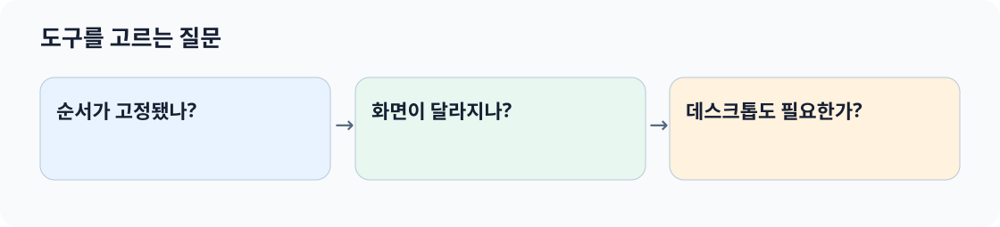

# 06. Browser Use·Playwright·컴퓨터 사용 도구

도구 이름이 많아도 역할을 기준으로 보면 선택이 쉬워집니다.

| 도구·프로젝트 | 핵심 역할 | 적합한 사람 |
|---|---|---|
| Playwright | 코드로 브라우저를 정밀하게 자동화 | 개발자·정해진 업무 |
| Browser Use | 자연어 목표와 브라우저 행동 연결 | 에이전트 실험·업무 자동화 |
| Browser Harness | AI 코딩 도구가 실제 Chrome을 사용하도록 연결 | 로그인된 브라우저를 제한적으로 사용 |
| 컴퓨터 사용 도구 | 화면 좌표·키보드·마우스 수준 제어 | 웹 밖의 데스크톱까지 다룰 때 |

마지막 행은 도구 유형의 예시입니다. 컴퓨터 사용 도구의 실제 지원 환경과 조작 방식은 공급자마다 다르며, 모든 제품이 내 데스크톱에 직접 연결되는 것은 아닙니다.

*그림: 순서가 고정됐는지, 화면이 달라지는지, 데스크톱 조작이 필요한지에 따라 도구를 고르는 질문입니다. 저자 제작 도식이며 실제 제품 화면이 아닙니다.*

## Playwright는 ‘정확한 조종기’다

Playwright는 특정 버튼·입력창을 찾고, 값을 넣고, 페이지 이동을 기다리는 규칙을 코드로 적는 도구입니다. 페이지 구조를 직접 지정하기 때문에 결과가 비교적 예측 가능하지만, 사이트가 바뀌면 코드 수정이 필요합니다. 비개발자는 전체 코드를 작성하기보다, 에이전트가 생성한 자동화가 어떤 사이트·요소·권한을 사용하는지 읽는 용도로 먼저 접하면 됩니다.

## Browser Use는 ‘목표 중심 조종기’다

Browser Use는 “이 사이트에서 조건에 맞는 항목을 찾아 표로 만들어 줘”처럼 목표를 주고 브라우저 에이전트가 여러 행동을 선택하도록 돕습니다. 유연한 만큼 잘못된 클릭·반복·비용·보안 문제가 생길 수 있어, 제한된 사이트와 낮은 위험 업무부터 테스트해야 합니다. 공식 저장소의 설치·모델·브라우저 연결 방식은 버전별로 달라질 수 있으므로 README를 기준으로 합니다.

## 도구를 고르는 순서

1. 결과가 정해진 반복 업무인가? → Playwright 같은 명시적 자동화
2. 페이지 구조가 자주 바뀌고 목표를 설명해야 하는가? → 브라우저 에이전트
3. 웹페이지 밖의 데스크톱 앱도 필요한가? → 컴퓨터 사용 도구
4. 로그인 세션을 사용할 것인가? → 별도 프로필·승인·감사 로그가 있는 도구

인기 있는 도구가 항상 나에게 맞는 도구는 아닙니다. GitHub star는 관심의 신호이고, 실제 선택은 업무 위험·지원 브라우저·데이터 보관·비용·재현성으로 결정합니다.

출처: [Playwright 공식 문서](https://playwright.dev/docs/intro), [Browser Use](https://github.com/browser-use/browser-use), [Browser Harness](https://github.com/browser-use/browser-harness).

## 2026년 11월 27일 기준 제품별 실행 방식

| 선택지 | 모델이 받는 관찰 | 실제 행동을 수행하는 곳 | 독자가 먼저 확인할 점 |
| --- | --- | --- | --- |
| [OpenAI Computer Use API](https://developers.openai.com/api/docs/guides/tools-computer-use) | 화면 캡처 | 개발자가 만든 행동 처리기 | API 호출 완료와 실제 클릭 성공의 구분 |
| [Anthropic Computer Use](https://platform.claude.com/docs/en/agents-and-tools/tool-use/computer-use-tool) | 화면 캡처 등 | 개발자 측 격리 환경 | 데스크톱 도구와 웹 전용 도구의 차이 |
| [Anthropic Browser Use](https://platform.claude.com/docs/en/agents-and-tools/tool-use/browser-use-tool) | 보이는 페이지 내용·요소 참조 | 개발자 측 브라우저 실행기 | 낡은 요소 참조와 허용 도메인 |
| [Google Computer Use](https://aistudio.google.com/docs/computer-use) | 화면 캡처 | 개발자가 마련한 클라이언트 실행 환경 | 브라우저·모바일·데스크톱별 지원 범위 |
| [Microsoft Foundry Browser Automation](https://learn.microsoft.com/en-us/azure/foundry/agents/how-to/tools/browser-automation) | 페이지 요소·스크린샷 등 | 관리형 원격 브라우저 | 계정 연결·사람의 개입·세션 기록 |
| [ChatGPT Work 클라우드 브라우저](https://help.openai.com/en/articles/20001280-using-cloud-browser-in-chatgpt) | 서비스가 관리하는 웹 작업 상태 | 서비스의 별도 클라우드 브라우저 | 사이트 접근 허가와 중요한 행동의 승인 |

API 도구는 개발자가 실행 환경을 마련해야 하는 경우가 많고, 사용자가 쓰는 완성형 서비스는 그 일부를 제공할 수 있습니다. 위 표는 동일한 성능이나 안전성의 순위가 아닙니다. 지원 모델·지역·요금·기능 이름은 변하므로 실제 선택 시 각 공식 페이지를 다시 확인해야 합니다. 과거의 `ChatGPT agent` 도움말은 현재 해당 기능이 종료되고 ChatGPT Work를 사용하라고 안내하므로, 이 책에서는 현재 사용자용 사례를 [ChatGPT Work의 클라우드 브라우저](https://help.openai.com/en/articles/20001280-using-cloud-browser-in-chatgpt)로 표시합니다.

## 공개 행사 A 양식에 어떤 도구를 고를까

다음 역시 **가상 업무에 대한 설계 비교**이며, 실제 제품을 실행해 성능을 비교한 결과가 아닙니다. “행사 조건을 읽고 제출 전 멈춘다”는 같은 목표라도, 업무가 얼마나 정해져 있고 누가 실행 환경을 관리하는지에 따라 선택이 달라집니다.

| 업무 조건 | 먼저 검토할 방식 | 선택 이유 | 도입 전에 검증할 제약 |
| --- | --- | --- | --- |
| 같은 공개 양식을 매번 같은 순서로 읽는다 | Playwright로 절차 고정 | 위치보다 라벨·역할을 지정해 반복 실행·검증 가능 | 양식이 바뀌면 선택자와 완료 검사를 수정해야 함 |
| 여러 행사 사이트를 돌아다니며 조건을 비교한다 | Browser Use 같은 목표 중심 에이전트 | 매 페이지에서 다음 탐색 경로를 고를 수 있음 | 잘못된 사이트·반복 탐색·비용·실패 기록을 점검해야 함 |
| 비개발자가 지원되는 사이트에서 위임한다 | ChatGPT Work 클라우드 브라우저 같은 완성형 서비스 | 별도 실행기를 직접 만들지 않고 작업을 맡길 수 있음 | 이용 가능 지역·요금제·사이트 차단·사람 승인 범위를 확인해야 함 |
| 조직이 실행 환경과 권한을 직접 설계한다 | OpenAI·Anthropic·Google의 컴퓨터 사용 API 또는 Microsoft Foundry | 격리 환경·도메인·승인·기록을 업무 정책에 맞출 여지가 있음 | 개발·운영 책임, 지원 환경, 기능 상태와 데이터 보관 조건을 확인해야 함 |

첫째 줄의 선택자와 완료 검사는 [Playwright 공식 문서](https://playwright.dev/docs/locators)의 요소 찾기와 [입력 안내](https://playwright.dev/docs/input)를 기준으로 검토할 수 있습니다. 셋째 줄은 [ChatGPT Work의 공식 안내](https://help.openai.com/en/articles/20001280-using-cloud-browser-in-chatgpt)가 사이트에 따라 작업이 차단되거나 마지막 단계를 사용자가 수행해야 할 수 있다고 설명합니다. 넷째 줄도 하나의 제품군이 아닙니다. [OpenAI Computer Use API](https://developers.openai.com/api/docs/guides/tools-computer-use)와 [Google Computer Use](https://aistudio.google.com/docs/computer-use)는 개발자 측 행동 실행기를 요구하고, [Microsoft Foundry Browser Automation](https://learn.microsoft.com/en-us/azure/foundry/agents/how-to/tools/browser-automation)은 관리형 원격 브라우저를 제공합니다.

선택 전에 다섯 가지를 한 문장씩 적어 보세요: **접근할 사이트**, **사용할 계정과 데이터**, **허용할 마지막 행동**, **사람이 승인할 순간**, **완료를 보여 줄 화면·파일·기록**. 행사 신청에서는 `신청하기` 버튼을 누르는 능력보다, 그 버튼 앞에서 멈추고 전송 내용을 보여 주며 접수 여부를 확인하는 능력이 더 중요한 선택 기준입니다.

## 같은 업무를 도구별로 설계한다면

매주 같은 보고서 페이지에서 공개 수치를 내려받는 일은 Playwright처럼 절차를 고정하기 쉽습니다. 사이트마다 다른 형식의 수치를 비교한다면 에이전트가 페이지를 읽고 경로를 고르는 방식이 도움이 될 수 있습니다. 데스크톱 앱까지 다뤄야 한다면 브라우저 밖의 화면을 지원하는 컴퓨터 사용 도구와 격리 환경을 확인해야 합니다. 이 문단은 선택을 돕는 가상 비교이며, 도구를 실제 실행한 결과는 아닙니다.

비교할 때는 “한 번 성공했는가”만 기록하지 마세요. 사이트가 바뀌었을 때의 실패, 계정 사용 범위, 사람이 고친 시간, 다운로드 파일의 정확성을 함께 적습니다. [Playwright 공식 문서](https://playwright.dev/docs/intro), [Browser Use 공식 저장소](https://github.com/browser-use/browser-use)를 확인하고 설치 방식은 실제 버전에 맞춰 선택하세요.
