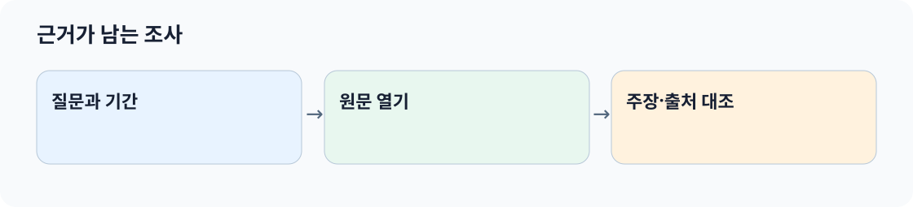

# 07. 검색과 자료조사를 맡기는 방법

AI 브라우저에 가장 먼저 맡기기 좋은 일은 공개 자료를 찾고 비교하는 작업입니다. 하지만 “검색해 줘”와 “근거가 남는 조사 보고서를 만들어 줘”는 다릅니다.



*그림: 이 장의 설명을 요약한 저자 제작 도식입니다. 실제 제품 화면이 아닙니다.*

## 검색 업무를 네 단계로 나누기

1. 질문을 검색 가능한 조건으로 바꾼다.
2. 서로 다른 출처를 찾는다.
3. 각 출처의 날짜·작성자·범위를 기록한다.
4. 원문과 요약이 일치하는지 검증한다.

### 따라 하기: 안전한 조사 요청

다음 형식으로 요청합니다.

```text
주제: 2026년 AI 브라우저 에이전트 동향
범위: 2026년 1월 이후 공개 자료
출처: 공식 문서·공식 저장소·원문 보고서 우선
결과: 주장, 근거 URL, 발행일, 확인일, 불확실성을 표로 작성
제한: 로그인·회원가입·다운로드·게시·결제는 하지 말 것
```

이렇게 하면 에이전트가 검색 결과의 제목만 보고 결론을 내리는 것을 줄일 수 있습니다. 검색 결과의 요약문은 원문이 아니므로, 중요한 숫자는 원문 페이지에서 다시 확인해야 합니다.

## 출처의 질을 구분하기

| 출처 | 장점 | 주의점 |
|---|---|---|
| 공식 문서 | 기능·제약을 가장 정확히 설명 | 장점을 강조할 수 있음 |
| 공식 GitHub | 코드·이슈·릴리스 확인 가능 | stars가 품질을 보장하지 않음 |
| 독립 보고서 | 여러 서비스 비교 | 조사 방법과 표본 확인 필요 |
| 뉴스 기사 | 사건 맥락 파악 | 원자료 링크 확인 필요 |
| 블로그·SNS | 빠른 사용 경험 | 광고·오류·재현성 부족 |

## 결과를 받을 때 확인할 것

에이전트가 “가장 인기 있다”고 말하면 인기의 측정 기준을 다시 묻습니다. GitHub stars인지, 실제 사용량인지, 설문 응답인지에 따라 의미가 다릅니다. 서로 다른 지표를 하나의 순위처럼 섞지 않습니다.

마지막으로 브라우저 기록·다운로드 파일·스크린샷을 보관합니다. 결과 문장만 남기면 나중에 어떤 페이지를 보고 쓴 것인지 확인할 수 없습니다.

## 조사표의 한 행을 검증하기

| 주장 | 원문에서 찾을 것 | 기록 |
| --- | --- | --- |
| “도구가 Chrome을 지원한다” | 공식 문서의 지원 브라우저 | 문서 URL·확인일 |
| “사용량이 늘었다” | 보고서의 지표와 표본 | 기간·측정 방법 |

서로 다른 기사 세 건이 같은 발표자료를 인용했다면 독립된 근거 세 건으로 세지 않습니다. 원자료 하나와 그 해설 둘로 구분하세요. 에이전트에게 각 주장 옆에 원문 링크와 해당 문단의 위치를 남기게 하면 검토 시간이 줄어듭니다. 수치가 없는 페이지를 보았는데도 숫자를 채워 넣었다면 그 칸은 “확인되지 않음”으로 고쳐야 합니다.
