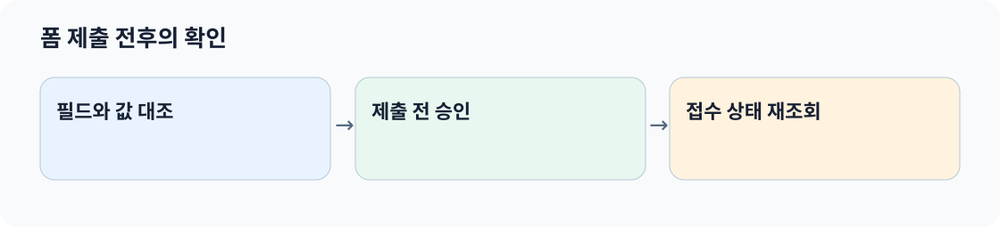

# 08. 폼 입력과 반복 업무 자동화

> 제품 자료 확인일: 2026-11-27. 이 장의 행사 장소 문의서는 가상 사례이며 실제 폼에 제출하지 않았습니다.

폼 입력은 AI 브라우저의 유용함이 잘 드러나는 동시에 실수가 바로 외부로 전달되는 작업입니다. 먼저 공개 정보 입력과 개인정보 입력을 나눕니다.

| 입력 종류 | 예시 | 기본 정책 |
|---|---|---|
| 공개 정보 | 검색어·필터·정렬 | 자동화 가능 |
| 업무 정보 | 내부 문서 제목·분류 | 범위 확인 후 자동화 |
| 개인정보 | 이름·전화번호·주소 | 입력 전 확인 |
| 인증 정보 | 비밀번호·OTP·API 키 | 대화에 붙여 넣지 않고 서비스가 제공하는 사용자 직접 입력 절차를 사용 |
| 외부 전송 | 신청서·메일·댓글 | 제출 직전 사람 승인 |



*그림: 입력값을 대조하고 제출 승인을 받은 뒤 실제 접수 상태를 다시 확인하는 절차입니다. 저자 제작 도식이며 실제 제품 화면이 아닙니다.*

## 따라 하기: 폼 자동화 전 체크리스트

1. 어느 사이트의 어느 폼인지 적습니다.
2. 입력할 필드와 입력하지 않을 필드를 목록으로 만듭니다.
3. 예시 데이터로 먼저 테스트합니다.
4. 필드별 값이 맞는지 화면에서 검토합니다.
5. 제출 버튼 앞에서 멈추도록 설정합니다.
6. 제출 뒤 완료 번호·확인 화면·메일을 확인합니다.

```text
공개 테스트 페이지에서만 진행해 줘.
이름과 주소는 예시 값을 사용해.
제출 버튼은 누르지 말고 입력 결과만 보여 줘.
필드 라벨과 입력값을 표로 정리해 줘.
```

## 반복은 복사가 아니라 검증의 문제다

같은 값을 여러 행에 입력할 때 에이전트가 한 행을 잘못 읽으면 오류가 반복됩니다. 10개를 한꺼번에 처리하기보다 첫 번째 행을 입력한 뒤 사람이 확인하고, 다음 두 행을 처리한 뒤 다시 확인하는 방식이 안전합니다.

## 제출 후 성공 판단

“버튼 클릭 완료”는 성공 조건이 아닙니다. 화면에 접수 번호가 나타났는지, 목록에 새 항목이 생겼는지, 전송한 값이 맞는지 확인해야 합니다. 확인할 수 없다면 에이전트는 성공이 아니라 “제출 시도”라고 기록해야 합니다.

## 행 하나를 안전하게 처리하기

예를 들어 행사 신청 양식 20건을 옮긴다면 처음 한 건은 샘플로 입력하고 사람에게 필드별 값을 보여 줍니다. 승인받은 뒤 작은 묶음으로 진행하며, 각 건에 원본 행 ID와 접수 결과를 연결합니다.

| 시점 | 남길 기록 |
| --- | --- |
| 입력 전 | 원본 행과 사이트 주소 |
| 제출 직전 | 필드별 값과 수신처 |
| 제출 뒤 | 접수 번호 또는 목록 상태 |

화면이 멈췄다고 다시 제출하면 중복 신청이 생길 수 있습니다. 접수 목록을 먼저 조회하고 결과가 불명확하면 사람에게 넘깁니다. [Playwright의 입력과 클릭 안내](https://playwright.dev/docs/input)는 자동화 동작을 설명하지만, 업무상의 승인 기준은 별도로 정해야 합니다.

## 장소 문의서를 작성만 한다면

7장에서 고른 장소의 문의 페이지를 연다고 가정해 봅시다. 에이전트는 이름·연락처·행사 날짜·참석 인원을 채우기 전에 **현재 도메인과 필드 라벨**을 보여 줘야 합니다. 화면 좌표가 같더라도 사이트가 바뀌면 다른 칸일 수 있습니다. `참석 인원 30명`이 `행사 시간 30분` 칸에 들어간 오류는 문장이 자연스럽다는 이유만으로 잡히지 않습니다.

| 순서 | 에이전트가 보여 줄 것 | 사람이 판단할 것 |
| --- | --- | --- |
| 입력 전 | 사이트 주소, 문의 대상, 필드 이름 | 올바른 업체와 양식인가 |
| 입력 후 | 필드별 실제 값이 보이는 화면 | 개인정보·날짜·인원이 정확한가 |
| 제출 전 | 수신처와 전송될 전체 문안 | 외부 전송을 승인할 것인가 |
| 제출 후 | 접수 번호·확인 메일·저장된 내역 | 중복 없이 접수됐는가 |

이 사례의 기본 중단점은 **제출 전**입니다. 화면에 값을 채우는 것과 업체에 정보를 전송하는 것은 다른 행동입니다. [ChatGPT Work의 클라우드 브라우저 안내](https://help.openai.com/en/articles/20001280-using-cloud-browser-in-chatgpt)도 사이트 접근, 로그인, 확인이 필요한 순간에 작업이 멈출 수 있다고 설명합니다. 이 제품 동작을 모든 브라우저 에이전트의 보장으로 일반화하지 않습니다.
