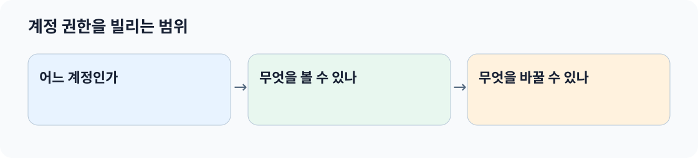

# 09. 로그인·계정·개인정보의 경계

> 제품 자료 확인일: 2026-11-27. 아래 계정 사례는 설명용이며 실제 계정에 로그인하지 않았습니다.

브라우저 에이전트가 로그인된 세션을 사용하면 편리하지만, 그 순간 에이전트는 사용자의 계정 권한을 빌립니다. 화면을 볼 수 있는 것과 계정의 모든 행동을 허용하는 것은 같은 뜻이 아닙니다.

*그림: 어느 계정을 쓰는지와 그 계정으로 읽거나 바꿀 수 있는 범위를 확인하는 순서입니다. 저자 제작 도식이며 실제 제품 화면이 아닙니다.*

## 계정 사용 수준

| 수준 | 예시 | 권장 환경 |
|---|---|---|
| 공개 | 로그인하지 않은 문서 읽기 | 기본 브라우저도 가능 |
| 읽기 전용 | 내 대시보드 조회 | 제한된 테스트 계정 |
| 작성 | 초안 저장·문서 생성 | 별도 작업 공간 |
| 전송 | 메일·게시·신청 | 항상 사람 승인 |
| 금전·권한 | 결제·권한 부여·삭제 | 기본적으로 사람이 직접 처리하거나 구체적 승인과 별도 확인을 요구 |

## 안전한 세션 만들기

1. 개인 계정이 아닌 테스트 계정을 만듭니다.
2. 필요한 사이트만 로그인합니다.
3. 결제수단과 자동 로그인 저장을 제거합니다.
4. 브라우저 프로필을 작업별로 분리합니다.
5. 작업이 끝나면 세션을 종료하고 쿠키를 삭제합니다.

비밀번호·일회용 코드·복구 코드·API 키를 채팅에 붙여 넣지 않습니다. 에이전트가 “로그인을 위해 비밀번호를 알려 달라”고 요청해도, 사용자가 직접 입력하거나 일회성 승인 화면을 이용합니다.

## 개인정보 최소화

자동화에 주소 전체가 필요하지 않다면 도시만 사용합니다. 주민등록번호·건강정보·금융정보처럼 민감한 정보는 브라우저 에이전트 실습의 데이터로 사용하지 않습니다. 스크린샷을 공유할 때 계정 이름·메일 주소·알림 내용이 보이지 않는지 확인합니다.

## 계정 오작동 점검

에이전트가 잘못된 계정으로 들어간 것 같다면 즉시 중단하고 현재 URL·프로필 이름·페이지 상단 계정 표시를 확인합니다. 로그인 페이지로 이동했다고 해서 올바른 계정으로 로그인했다는 뜻은 아닙니다.

## 세션 시작·종료 기록

| 시점 | 기록할 것 |
| --- | --- |
| 시작 | 프로필 이름, 로그인된 사이트, 허용 작업 |
| 진행 중 | 새 탭·도메인·권한 요청 |
| 종료 | 남은 탭, 다운로드, 로그인 상태 |

고객지원 시스템을 읽는 실습이라면 조회용 계정과 실제 답변 발송 계정을 분리하는 편이 좋습니다. 에이전트가 조회한 고객의 정보가 스크린샷이나 로그에 남을 수 있으므로, 결과를 공유하기 전에 화면의 이름·주소·메일을 다시 살핍니다. [Playwright의 인증 상태 안내](https://playwright.dev/docs/auth)는 세션 재사용 방법을 설명하며, 저장된 인증 상태를 민감한 자료로 취급하도록 경고합니다.

## 장소 문의 사이트가 로그인을 요구할 때

7~8장의 문의 양식이 계정 로그인 뒤에만 보인다면 작업을 잠시 멈춥니다. 에이전트에게 비밀번호를 채팅으로 보내거나, 다른 사이트에서 재사용한 인증 상태 파일을 넘겨주지 않습니다. 사용자는 도메인을 직접 확인하고 서비스가 제공하는 로그인 절차로 인증합니다. 로그인 뒤에도 에이전트가 사용할 수 있는 범위는 **그 업체의 문의 초안 작성**으로 제한합니다. 계정에 이전 예약 내역이 보인다고 해서 그것을 읽거나 수정할 권한을 얻은 것은 아닙니다.

[ChatGPT Work 클라우드 브라우저](https://help.openai.com/en/articles/20001280-using-cloud-browser-in-chatgpt)는 지원되는 사이트에서 사용자에게 보안 로그인 양식을 보여 주며, 그 양식에 입력한 자격 증명은 모델에 보이지 않는다고 설명합니다. 이는 해당 제품의 설명입니다. 다른 도구에서는 누가 비밀번호를 받는지, 브라우저 프로필이 어디에 보관되는지 따로 확인해야 합니다.

## 로그인 전·후의 권한을 분리해서 연습하기

행사 장소 사이트에서 문의 초안을 작성하려면 로그인해야 한다고 가정해 봅시다. 사용자가 보는 로그인 페이지와 에이전트가 읽는 작업 화면은 이어져 있지만, 허용 범위는 자동으로 넓어지지 않습니다. 다음 표의 왼쪽은 계정 접속을 돕는 절차이고 오른쪽은 로그인한 뒤의 업무 권한입니다.

| 시점 | 사용자가 직접 확인할 것 | 에이전트에게 허용할 것 | 멈출 조건 |
| --- | --- | --- | --- |
| 로그인 요청 전 | 주소창의 정확한 도메인, 로그인 화면의 출처 | 해당 사이트 접속 요청과 화면 읽기 | 예상하지 못한 도메인·팝업·계정 연결 요구 |
| 비밀번호·OTP 입력 | 서비스가 제공하는 직접 입력 또는 인계 화면 | 입력값 자체는 채팅으로 전달하지 않음 | 채팅으로 코드를 요구하거나 다른 사이트로 이동 |
| 로그인 뒤 | 화면에 표시된 계정과 작업 공간 | 행사 문의 양식 열기와 초안 작성 | 이전 예약·청구 정보·다른 고객 정보 접근 |
| 작업 종료 | 제출 여부, 남은 로그인 세션과 다운로드 | 새 작업을 시작하지 않음 | 계정이 예상과 다르거나 작업 상태가 불명확함 |

로그인 성공은 **문의 제출 승인**이 아닙니다. 사용자가 직접 인증한 뒤에도 에이전트의 다음 클릭은 원래 요청의 범위 안에 있어야 합니다. 화면에 결제수단이나 과거 예약 내역이 나타나면 그 부분을 읽지 않고 문의 양식으로 돌아가는 것이 원칙입니다. 공개 자료를 조사하는 데 로그인 자체가 필요 없다면 계정을 연결하지 않는 편이 좋습니다.

세션 종료 방식은 제품마다 다릅니다. 예를 들어 [ChatGPT Work 안내](https://help.openai.com/en/articles/20001280-using-cloud-browser-in-chatgpt)는 클라우드 브라우저의 로그인 상태가 이후 작업에도 남을 수 있으며, 설정에서 사이트별 쿠키를 지우면 로그아웃된다고 설명합니다. 그러므로 **작업 종료**와 **로그인 세션 종료**를 별도로 확인해야 합니다. 다른 실행 환경에서는 제공자가 안내하는 로그아웃·프로필 삭제 절차를 확인하고, 저장된 인증 상태 파일이 있다면 접근 권한을 제한합니다.
