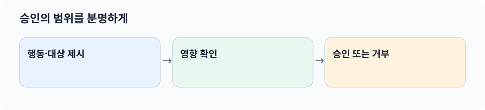

# 11. 승인·권한·브라우저 세션 보호

> 제품 자료 확인일: 2026-11-27. 아래 승인 카드는 제품 화면을 복제한 것이 아니라 설명용 양식입니다.

AI 브라우저를 안전하게 운영하는 핵심은 “할 수 있는가”와 “해도 되는가”를 분리하는 것입니다. 기술적으로 클릭할 수 있어도 사용자가 승인하지 않았다면 실행하면 안 됩니다.



*그림: 행동과 대상을 제시하고 영향을 확인한 뒤 사람이 승인하거나 거부하는 흐름입니다. 저자 제작 도식이며 실제 제품 화면이 아닙니다.*

## 권한을 네 층으로 나누기

1. **관찰 권한**: 페이지를 읽고 화면을 캡처한다.
2. **탐색 권한**: 링크를 열고 검색어를 입력한다.
3. **변경 권한**: 문서를 만들고 장바구니를 수정한다.
4. **외부 효과 권한**: 제출·메일·결제·삭제를 실행한다.

첫 실습은 1·2단계만 허용합니다. 3단계는 테스트 계정에서, 4단계는 사람이 마지막으로 직접 실행하는 것을 기본값으로 둡니다.

## 승인 요청에 들어갈 내용

에이전트가 승인을 요청할 때 “진행할까요?”만 말하면 안 됩니다. 다음을 보여 줘야 합니다.

- 어느 사이트와 계정인가
- 어떤 값이 입력되어 있는가
- 어떤 사람·조직에 전달되는가
- 결과가 되돌릴 수 있는가
- 지금 승인하면 어떤 외부 효과가 생기는가

## 브라우저 세션 보호

공유 화면이나 로그에 쿠키·토큰·개인정보가 찍히지 않게 합니다. 자동화 도구의 디버그 로그는 필요한 경우에도 값 일부를 마스킹합니다. 작업이 끝나면 열린 탭과 다운로드 폴더를 정리하고, 공유 컴퓨터에서는 프로필을 로그아웃합니다.

## 승인 거부도 정상 결과다

사용자가 승인을 거부했을 때 에이전트는 다른 방법으로 우회하지 않고 중단해야 합니다. 거부를 실패로 취급해 계속 시도하면 권한 경계를 무너뜨리는 행동이 됩니다.

## 승인 카드를 읽는 순서

“다음으로 진행할까요?”라는 질문만으로는 충분하지 않습니다. 예를 들어 고객 50명에게 메일을 보내는 작업이라면 수신자 목록, 실제 문안, 발송 계정, 예약 시각을 보여 줘야 합니다.

| 질문 | 답이 없을 때 |
| --- | --- |
| 누구에게 보내는가 | 발송 보류 |
| 어떤 내용을 보내는가 | 문안 수정 |
| 거부하면 어떻게 되는가 | 초안만 저장 |

승인 뒤에도 실행 기록과 보낸 편지함을 확인하세요. 승인은 행동을 허용한 기록이고, 전달 성공은 별도의 증거입니다. 공개 페이지를 읽는 권한과 사용자의 계정으로 외부에 전송하는 권한은 계속 분리해야 합니다.

## 장소 문의의 승인 카드를 실제로 적어 보기

8장의 양식을 모두 채웠다면 에이전트는 다음 내용을 한 화면에 모아 보여 줄 수 있어야 합니다. “문의서 제출을 승인하시겠습니까?”만 묻는 것은 충분하지 않습니다.

```text
보낼 곳: 예시 장소 A의 공식 문의 페이지 (정확한 주소 표시)
사용 계정: 행사 준비용 계정 (계정 식별 정보 확인)
전송 내용: 행사 날짜, 인원 30명, 담당자 이름과 연락처
예상 효과: 업체가 문의 내용을 받음; 전송 후 완전 회수는 어려울 수 있음
현재 상태: 입력 완료, 제출 전 정지
승인하지 않을 때: 초안만 보관하고 제출하지 않음
```

사용자가 승인해도 사이트 접근 승인이 곧 문의 제출 승인이라는 뜻은 아닙니다. [ChatGPT Work 클라우드 브라우저](https://help.openai.com/en/articles/20001280-using-cloud-browser-in-chatgpt)는 사이트 접근·로그인·확인 요청을 별도 단계로 안내합니다. [Microsoft Foundry](https://learn.microsoft.com/en-us/azure/foundry/agents/how-to/tools/browser-automation) 역시 결과가 큰 행동에는 사람의 승인을 요구하라고 안내합니다. 책의 카드는 이런 경계를 이해하기 위한 편집 예시이며 모든 제품의 동일한 UI를 뜻하지 않습니다.

## 승인 전에 무엇을 비교해야 하나

업체의 문의서는 예약이나 결제가 아닐 수 있지만, 담당자의 연락처가 외부로 전달되고 문의를 완전히 회수하기 어렵습니다. 따라서 **입력 화면**과 **전송될 결과**를 나란히 놓아야 합니다. 행사 날짜가 맞아도 수신 업체가 다른 곳이면 승인하면 안 됩니다. 수신 업체가 맞아도 연락처를 개인 휴대전화 대신 업무용 주소로 바꿔야 할 수 있습니다.

| 검토 항목 | 승인 카드에 넣을 실제 정보 | 다르면 할 일 |
| --- | --- | --- |
| 대상 | 업체명, 정확한 도메인, 문의 수신처 | 페이지를 닫고 공식 주소에서 다시 시작 |
| 값 | 행사 날짜·인원·문의 문안·담당자 연락처 | 필드를 고친 뒤 새 화면을 다시 검토 |
| 외부 효과 | 문의 기록 생성, 업체에 개인정보 전달 | 필요 최소 정보만 남기고 동의 여부 판단 |
| 되돌림 가능성 | 초안은 삭제 가능, 이미 보낸 문의는 회수 불확실 | 전송을 보류하거나 사람이 직접 제출 |
| 승인 범위 | 이 문의서 한 건의 제출 | 추가 예약·결제·파일 업로드는 새 승인 요청 |

승인 화면에 값이 가려져 있거나 스크롤 아래 필드가 남아 있다면 “보이는 부분만” 승인한 셈이 되기 쉽습니다. 에이전트가 전체 문안을 별도 요약하더라도 사람이 실제 입력값과 대조할 수 있어야 합니다. 승인 뒤 페이지가 새로고침되며 값이 바뀌면 이전 승인을 그대로 사용하지 않고 다시 확인합니다. 사용자의 **거부**나 **수정 요청**은 정상적인 중단 신호이며, 에이전트가 다른 버튼이나 도메인으로 우회해서는 안 됩니다.

이 표는 책을 위한 교육용 승인 설계입니다. [OpenAI의 클라우드 브라우저 안내](https://help.openai.com/en/articles/20001280-using-cloud-browser-in-chatgpt)는 사이트 접근 허가와 결과가 큰 행동의 확인을 구분하고, [Anthropic의 컴퓨터 사용 문서](https://platform.claude.com/docs/en/agents-and-tools/tool-use/computer-use-tool)는 현실에 중요한 영향을 미치는 결정과 동의가 필요한 작업에서 사람의 확인을 권합니다. 실제 제품마다 중단점과 화면 형태가 다르므로 이 표를 제품의 공통 보장으로 읽으면 안 됩니다.
