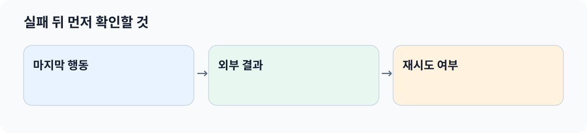

# 12. 실패·재시도·중단·복구

> 제품 자료 확인일: 2026-11-27. 아래 제출 중단은 가상 사례이며 실제 사이트 장애를 재현한 결과가 아닙니다.

브라우저 에이전트는 실패합니다. 버튼을 못 찾거나, 페이지가 늦게 열리거나, 결과를 잘못 해석할 수 있습니다. 중요한 것은 실패하지 않는다는 약속이 아니라 실패했을 때 피해를 제한하는 구조입니다.



*그림: 실패 후 마지막 행동과 외부의 실제 결과를 확인하고 재시도 여부를 정하는 순서입니다. 저자 제작 도식이며 실제 제품 화면이 아닙니다.*

## 실패 종류

| 실패 | 예시 | 첫 대응 |
|---|---|---|
| 관찰 실패 | 버튼·페이지 제목을 못 찾음 | 화면과 URL 다시 확인 |
| 시간 초과 | 로딩이 끝나지 않음 | 마지막 행동과 외부 처리 여부를 먼저 확인. 읽기 화면만 멈춘 경우에 한해 새로고침 검토 |
| 권한 실패 | 로그인·접근 거부 | 사람에게 상태 보고 |
| 의미 실패 | 다른 상품·계정을 선택 | 즉시 중단하고 되돌리기 |
| 외부 효과 실패 | 제출 결과 불명확 | 중복 제출하지 말고 확인 |

## 재시도 규칙

같은 행동을 무조건 반복하지 않습니다. 한 번 실패하면 현재 화면이 바뀌었는지 확인하고, 두 번째에는 다른 관찰 방법을 사용합니다. 제출 결과가 불명확할 때는 재클릭보다 접수 목록·확인 메일을 먼저 확인합니다.

## 따라 하기: 멈춤 후 복구

1. 에이전트에게 “중단하고 현재 URL·페이지 제목·마지막 행동을 보고하라”고 합니다.
2. 외부 효과가 발생했는지 확인합니다.
3. 중복 실행 위험이 있으면 새 시도를 하지 않습니다.
4. 브라우저 탭과 세션을 보존합니다.
5. 사람이 직접 정상 상태로 되돌립니다.
6. 실패 원인과 다시 시도하지 않은 이유를 기록합니다.

## 재개 가능한 작업

긴 자료조사는 이미 확인한 URL과 완료한 항목을 파일에 기록해 두면 중단 후 이어갈 수 있습니다. “처음부터 다시 해”보다 “완료 목록을 읽고 미완료 항목만 처리해”가 안전합니다. 단, 페이지 내용이나 가격이 바뀌었는지 재확인해야 합니다.

## 중복 제출을 막는 결정표

| 외부 상태 | 다음 행동 |
| --- | --- |
| 접수 번호가 있음 | 새 제출을 하지 않고 내용 대조 |
| 미접수가 별도 근거로 확인됨 | 원인을 고친 뒤 사람 승인 아래 제한된 재시도 |
| 결과를 확인할 수 없음 | 사람에게 넘기고 재시도 보류 |

예를 들어 예약 버튼을 누른 뒤 화면이 멈췄다면 “실패”라고 단정하지 않습니다. 이메일, 예약 목록, 결제 내역을 순서대로 확인합니다. 이미 처리됐다면 브라우저 작업을 중단하더라도 예약 자체는 남습니다. 기술적 재시도보다 **외부 상태 확인**이 먼저라는 원칙은 결제·신청·메일 발송에도 적용됩니다.

## 문의서 제출 뒤 화면이 멈춘 경우

11장에서 사용자가 문의서 제출을 승인했고, 에이전트가 버튼을 한 번 눌렀다고 가정합니다. 곧바로 브라우저가 멈추면 제출 실패·성공 어느 쪽도 확정하지 않습니다. 마지막 행동 시각, 대상 URL, 화면을 먼저 보존합니다. 가능하다면 문의 내역이나 확인 메일을 **읽기 권한으로** 확인합니다. 둘 중 하나에 접수 기록이 있으면 다시 누르지 않고 내용만 대조합니다.

| 확인 결과 | 다음 단계 |
| --- | --- |
| 접수 번호와 내용이 일치 | 완료 후보로 기록하고 13장의 의미 검증으로 이동 |
| 접수 내역이 보이지 않음 | 사이트가 아직 반영 중인지 확인하고 제한된 재시도 여부를 사람이 결정 |
| 확인할 방법이 없음 | 상태 미확인으로 남기고 업체 또는 담당자에게 문의 |

“한 번 더 클릭”은 새로운 외부 전송일 수 있습니다. 재시도 횟수를 정하는 것보다 **중복 효과를 감지할 방법**을 먼저 설계해야 합니다. 에이전트에게 스스로 재시도할 수 있는 동작(예: 검색 조건 변경)과 승인 없이 재시도할 수 없는 동작(예: 문의 제출)을 구분해 줍니다.

## 타임아웃 뒤의 중단·재개 기록

버튼을 누른 뒤 화면이 멈춘 사실은 **브라우저에서 확인 응답을 받지 못했다**는 뜻입니다. 업체가 요청을 받지 않았다는 뜻은 아닙니다. 반대로 화면이 잠시 “처리 중”이라고 보였다고 해서 접수가 확정된 것도 아닙니다. 이 두 상태를 구분하지 않으면 재시도가 중복 문의를 만들 수 있습니다.

| 기록할 시점 | 남길 사실 | 다음 행동 |
| --- | --- | --- |
| 중단 직전 | 대상 도메인·계정, 제출 버튼을 누른 시각과 횟수 | 같은 버튼을 다시 누르지 않음 |
| 외부 상태 확인 | 접수 번호, 문의 내역, 확인 메일의 존재와 내용 | 원래 문안·업체와 대조 |
| 상태 판정 | 접수 확인·미접수 확인·판단 불가 중 하나 | 판단 불가이면 사람에게 인계 |
| 재개 결정 | 누가 언제 어떤 근거로 새 제출을 허용했는지 | 새 승인 범위 안에서만 재시도 |

예를 들어 화면은 멈췄지만 같은 문의 문안과 접수 번호가 목록에 보이면 **접수 확인**입니다. 화면은 멈췄고 목록에도 아직 없지만 시스템의 반영 지연 여부를 알 수 없다면 **판단 불가**입니다. “목록에 없음” 하나만으로 즉시 미접수라 단정할 수 없습니다. 확인 메일이 오지 않는 것도 메일 지연 가능성을 남깁니다. 접수 상태를 더 확인할 방법이 없을 때는 담당자가 업체에 문의하거나 일정 시간 뒤 다시 확인하도록 기록합니다.

재개할 때는 에이전트에게 기존 초안과 마지막 화면을 보여 주되, **이미 한 행동을 다시 실행하라**고 뭉뚱그려 지시하지 않습니다. 아직 처리하지 않은 단계만 지정하고, 문의 제출은 새로 판단합니다. 비밀번호나 OTP를 재사용하지 않고 필요하면 사용자가 직접 다시 인증합니다. 아래 인계문은 교육용 예시이며 실제 장애 대응 결과가 아닙니다.

```text
목표: 행사 장소 A에 30명 교육 행사 문의
마지막 확인: 14:03에 제출 버튼 1회 클릭, 확인 화면 수신 전 타임아웃
외부 상태: 문의 내역 조회 불가, 확인 메일 아직 없음
판정: 접수 여부 미확인
금지: 같은 문의서 재제출·결제·새 계정 연결
다음 담당자: 공식 문의 내역 또는 업체 확인 후 재개 여부 결정
```
