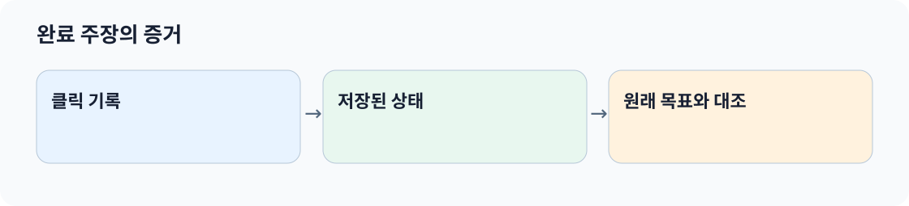

# 13. 결과를 검증하고 기록하는 방법

에이전트의 말보다 결과를 믿어야 합니다. “완료했습니다”라는 문장은 보고일 뿐 증거가 아닙니다.



*그림: 이 장의 설명을 요약한 저자 제작 도식입니다. 실제 제품 화면이 아닙니다.*

## 결과 증거의 종류

| 결과 | 확인할 증거 |
|---|---|
| 검색 | 출처 URL·검색 날짜·원문 제목 |
| 파일 생성 | 파일명·위치·열어 본 내용 |
| 폼 저장 | 저장된 목록·수정 시각 |
| 메시지 전송 | 보낸 편지함·수신 확인 |
| 예약·주문 | 확인 번호·상태 페이지 |

## 3단계 검증

1. **행동 검증**: 클릭·입력·이동이 실제로 실행됐는가
2. **상태 검증**: 페이지·파일·목록이 원하는 상태인가
3. **의미 검증**: 대상·수량·날짜·권한이 의도와 맞는가

예를 들어 파일을 업로드했다면 업로드 버튼을 눌렀다는 로그만으로 부족합니다. 올바른 파일이 올바른 폴더에 있고, 업로드된 파일을 다시 열 수 있으며, 공유 범위가 맞는지 확인해야 합니다.

## 기록 템플릿

```text
목표:
실행 시각:
사이트/계정:
에이전트가 수행한 행동:
확인한 결과:
증거 URL·파일·스크린샷:
사람이 직접 확인한 항목:
남은 불확실성:
```

검증 기록은 에이전트를 감시하기 위한 벌점표가 아니라, 다음 실행의 출발점입니다. 실패한 작업도 기록이 있으면 같은 실수를 줄일 수 있습니다.

## 같은 화면을 다른 사람이 검토하기

에이전트가 “파일을 업로드했다”고 보고하면 검토자는 파일명과 폴더만 보지 않습니다. 파일을 다시 열어 내용이 맞는지, 공유 대상이 의도한 사람인지, 이전 파일을 덮어쓰지 않았는지 확인합니다.

| 검증 층 | 업로드 예시 |
| --- | --- |
| 행동 | 업로드 버튼을 누른 기록 |
| 상태 | 목록에 새 파일이 표시됨 |
| 의미 | 올바른 파일과 공유 범위 |

기록 템플릿에는 실패와 미확인 항목도 남기세요. 확인할 수 없는 결과는 “완료”가 아니라 “판단 보류”로 표시하면 다음 사람이 중복 행동을 피할 수 있습니다.
