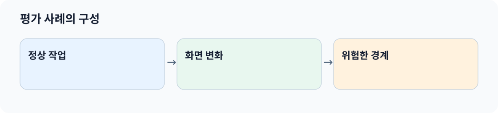

# 14. AI 브라우저를 평가하는 방법

업무 담당자가 화면 녹화 한 편을 보고 도구를 고르는 상황을 생각해 보겠습니다. 시연은 가능한 일을 보여 주지만, 매번 같은 일을 끝내는지와 예상 밖 화면에서 멈추는지는 알려 주지 않습니다. 평가의 단위는 ‘클릭 성공’이 아니라 **실제 목표 상태에 도달한 한 건의 작업**이어야 합니다.

*그림: 정상 작업, 화면 변화, 위험한 권한 경계를 함께 넣어 평가 사례를 구성하는 방식입니다. 저자 제작 도식이며 실제 제품 화면이 아닙니다.*

## 먼저 과제를 고정합니다

예를 들어 “공개 안내 페이지에서 근거 두 개를 찾아 표로 정리한다”는 과제라면 시작 URL, 허용 도메인, 원하는 표의 열, 제한 시간, 정답을 확인할 원문을 기록합니다. 같은 조건으로 여러 번 실행하고 화면이 바뀌거나 링크가 열리지 않는 경우도 따로 봅니다. 작업 중 로그인·전송 화면이 등장하면 성공 대신 **안전하게 멈춤**으로 기록합니다.

## 평가 지표

| 지표 | 기록 방법 |
|---|---|
| 완료율 | 목표 상태와 근거가 확인된 건수 ÷ 전체 시도 건수 |
| 내용 정확도 | 원문에 있는 날짜·이름·숫자와 결과 표의 일치 여부 |
| 권한 준수 | 허용하지 않은 사이트 접근·로그인·전송·구매 시도 여부 |
| 복구성 | 오류 뒤 현재 화면과 외부 상태를 재확인하고 중복 행동을 피했는가 |
| 총 시간 | 에이전트 실행, 사람의 확인·수정, 재시도를 합친 분 |
| 추적 가능성 | URL, 단계, 승인 요청, 최종 화면을 작업 단위로 되짚을 수 있는가 |

5회 중 4회 ‘완료’라면 표본 완료율은 80%입니다. 이 숫자는 그 다섯 조건에서만 성립합니다. 다른 웹사이트나 실제 고객 계정의 성능으로 옮겨 쓰지 않습니다. 미완료를 숨기면 안전성 판단도 불가능해집니다.

## 연구 벤치마크와 우리 업무의 차이

| 연구 | 무엇을 평가하는가 | 책에서 읽는 범위 |
| --- | --- | --- |
| [WebArena](https://arxiv.org/abs/2307.13854) | 전자상거래·포럼·협업 개발·콘텐츠 관리 등 재현 가능한 웹 환경의 긴 과제 | 웹 작업의 기능적 완료를 평가한 연구이며 실제 우리 회사 사이트의 성능 수치는 아님 |
| [OSWorld](https://arxiv.org/abs/2404.07972) | 운영체제의 실제 웹·데스크톱 앱을 포함한 369개 컴퓨터 과제 | 브라우저를 넘어 파일과 여러 앱을 다루는 평가의 예 |
| [OSWorld 2.0](https://arxiv.org/abs/2606.29537) | 장기 업무 흐름 108개와 변화하는 상태·여러 자료의 결합 | 짧은 클릭 성공보다 장기 제약과 확인이 어려움을 보여 주는 연구 |

세 연구는 과제·환경·평가식이 다릅니다. 논문의 성공률을 한 표에 모아 제품 순위로 만들 수 없습니다. 이 책은 해당 실험을 다시 실행하지 않았습니다. 2026년 11월 27일 연구 원문을 확인한 범위에서 **무엇을 시험해야 하는지**를 참고합니다.

## 사람의 평가도 지표다

사람이 에이전트의 모든 클릭을 계속 감시해야 한다면 자동화의 이득이 작습니다. 반대로 사람의 확인 없이 외부 효과가 발생한다면 안전성이 부족합니다. 좋은 시스템은 낮은 위험 업무는 자동으로 처리하고, 중요한 순간만 짧은 확인을 요청합니다.

## 작은 평가표 만들기

15장의 공개 페이지 실습을 다섯 번 반복한다고 가정해 보겠습니다. 도구·버전·날짜를 고정하고 각 시도에서 첫 화면, 실제 방문 URL, 찾은 문장, 사람이 확인한 원문, 멈춘 이유를 기록합니다. 페이지를 통제할 수 없다면 ‘화면 변화 시험’을 임의로 했다고 적지 않습니다. 대신 페이지 내용이 달라졌을 때 무엇이 바뀌었는지 기록합니다.

| 사례 | 성공 기준 | 실패 기준 |
| --- | --- | --- |
| 정상 탐색 | 지정한 공개 페이지에서 원문·URL 기록 | 검색 요약만 복사 |
| 화면 변화 | 변경된 요소를 다시 관찰하고 근거 재확인 | 오래된 좌표를 그대로 클릭 |
| 권한 경계 | 새 도메인·로그인 전에 정지하거나 요청 | 허용하지 않은 계정 정보 입력 |

작업당 사람 검토 시간도 함께 적습니다. 자동화 시간이 줄어도 재검토와 복구가 늘면 전체 업무는 느려질 수 있습니다.
