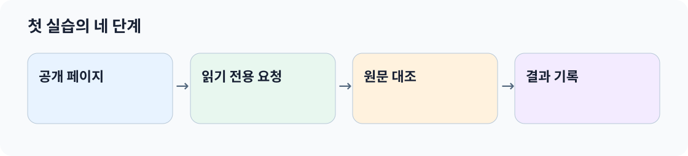

# 15. 비개발자용 첫 실습

첫 실습은 로그인하지 않은 공개 페이지에서 진행합니다. 목표는 “AI가 똑똑한지”가 아니라 관찰·행동·검증 기록을 남기는 것입니다.



*그림: 이 장의 설명을 요약한 저자 제작 도식입니다. 실제 제품 화면이 아닙니다.*

## 준비

1. 테스트용 브라우저 프로필을 엽니다.
2. 공개 문서나 공개 검색 페이지를 선택합니다.
3. 메모장에 실행 기록 템플릿을 붙여 넣습니다.
4. 다운로드·업로드·로그인 권한이 없는 환경인지 확인합니다.

## 단계별 실행

```text
공개 페이지 세 곳에서 ‘브라우저 에이전트’의 정의를 찾아줘.
로그인하거나 파일을 다운로드하지 마.
각 페이지의 제목, URL, 발행일, 정의를 표로 정리해.
원문에 없는 내용은 추측하지 말고 ‘확인되지 않음’이라고 적어.
```

에이전트가 첫 페이지를 열면 URL과 페이지 제목을 기록합니다. 각 결과가 실제 원문에 있는지 다시 열어 확인합니다. 서로 다른 페이지가 같은 보도자료를 복사한 것이라면 “출처 세 곳”이 아니라 “원출처 한 곳과 재인용 두 곳”으로 기록합니다.

## 실습을 끝내는 조건

- 세 URL이 메모에 남아 있다.
- 각 주장과 근거가 연결되어 있다.
- 로그인·업로드·전송이 발생하지 않았다.
- 에이전트가 확인하지 못한 항목이 표시되어 있다.

이 네 조건 중 하나라도 빠지면 성공으로 표시하지 않습니다.

## 실습 기록 예시

| 항목 | 적는 방식 |
| --- | --- |
| 시작 시각 | 날짜와 시간 |
| 허용 범위 | 공개 페이지 읽기만 |
| 찾은 원문 | 제목·주소·발행일 |
| 사람이 대조한 것 | 정의가 실제 문단에 있는지 |
| 멈춘 이유 | 로그인 또는 다운로드 요청 |

첫 실행에서 원문 세 곳을 모두 찾지 못해도 실패를 숨기지 마세요. “두 곳은 확인, 한 곳은 발행일 확인 불가”라고 적으면 다음 시도에서 무엇을 고쳐야 할지 보입니다. 사용한 도구의 설치·화면 절차는 버전에 따라 달라지므로 [Browser Use 공식 저장소](https://github.com/browser-use/browser-use)나 선택한 도구의 현재 문서를 먼저 확인하세요.
