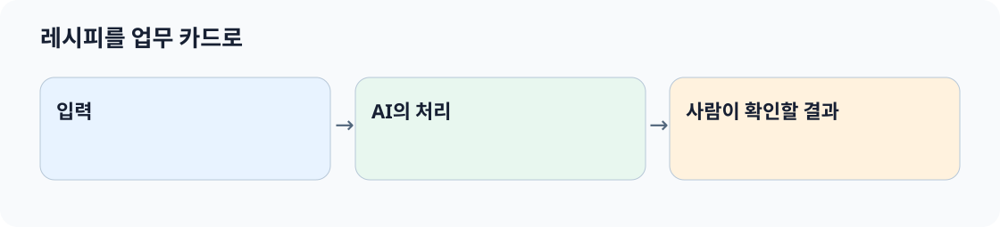

# 16. 업무별 자동화 레시피

‘이 일 좀 다 해 줘’는 사람에게도 모호한 지시입니다. 브라우저 에이전트에게는 **시작 자료, 허용한 행동, 제출 전 멈춤 지점, 사람이 확인할 결과**를 먼저 정합니다. 아래 레시피는 실제 제품에서 실행한 결과가 아니라 업무를 설계할 때 채울 예시입니다.

*그림: 업무 입력과 AI의 처리, 사람이 확인할 결과를 한 장의 작업 카드로 묶는 방식입니다. 저자 제작 도식이며 실제 제품 화면이 아닙니다.*

## 레시피 1: 공개 자료 조사

홍보 담당자가 행사 소개문에 쓸 공식 행사 시간을 확인한다고 해 보겠습니다. 시작 입력은 행사명, 주최 기관의 공식 URL, 확인할 연도입니다. 에이전트에게는 **해당 사이트에서만** 날짜·장소·시간을 찾아 원문 문장과 URL을 표로 남기게 합니다. 예상 출력은 `항목 | 값 | 원문 URL | 페이지 확인일 | 불확실성` 열을 가진 초안입니다. 사람이 주최 기관의 원문과 표를 대조하기 전에는 행사 소개문에 옮기지 않습니다. 로그인이나 유료 문서가 나오면 멈춥니다.

## 레시피 2: 회의 준비

공개 회의 자료 두 건과 작성자가 제공한 안건 목록만 입력으로 줍니다. 에이전트는 회의 전에 읽을 순서, 서로 모순되는 표현, 확인할 질문을 한 페이지에 정리합니다. **발송은 다른 행동**입니다. 참석자 주소, 비공개 메모, 최종 문안은 사람이 확인하고 별도 승인합니다. 링크가 깨진 경우에는 빈칸을 메우지 않고 ‘원문 접근 불가’라고 적습니다.

## 레시피 3: 상품 비교

예산 상한과 반드시 필요한 규격을 적고, 비교할 공식 판매 페이지를 지정합니다. 에이전트는 상품명, 규격, 표시 가격, 배송 조건, 확인 시간을 표로 정리합니다. 예상 출력은 **비교표**이며 주문이 아닙니다. 가격과 재고는 바뀔 수 있으므로 사람이 페이지를 다시 열어 최종 조건을 확인합니다. 장바구니·주소 입력·결제는 이 레시피의 허용 범위 밖입니다.

## 레시피 4: 사내 문서 정리

승인된 시험 폴더의 **가상 자료**로 먼저 시작합니다. 파일명, 작성일, 문서 종류만 읽어 분류 초안을 만들게 합니다. 원본 이동·삭제, 외부 업로드, 접근 권한 변경은 하지 않습니다. 실제 사내 자료로 확대하려면 보관 위치와 모델에 전송되는 정보를 먼저 확인하고 조직의 승인 절차를 따릅니다.

네 레시피 모두에서 ‘찾아서 정리’와 ‘외부 상태 변경’을 서로 다른 단계로 둡니다. 에이전트가 어떤 클릭을 제안했는지보다 **어떤 최종 상태를 사람이 확인했는지**를 완료 증거로 삼습니다.

## 실행 전 한 장짜리 업무 카드

| 칸 | 적을 내용 | 자료 조사 예시 |
| --- | --- | --- |
| 입력 | 시작 URL·자료·기간 | 행사 공식 사이트와 올해 안내 |
| 허용 행동 | 읽기·스크롤·정리 | 지정한 공개 사이트 열람 |
| 멈춤 | 새 사이트·로그인·외부 변경 | 비공개 등록 페이지 등장 |
| 예상 출력 | 표의 열과 누락 표시 | 날짜·장소·시간·원문 URL |
| 사람의 검증 | 실제 원문 대조 | 시간과 장소를 해당 페이지에서 재확인 |
| 실제 결과 | 실행 뒤 채울 기록 | 실행 전에는 빈칸 |

한 건을 실행한 뒤에는 성공 여부뿐 아니라 **수정에 걸린 시간과 멈춘 이유**를 기록합니다. 다음 장의 총비용은 그 기록을 바탕으로 계산합니다. 이 레시피의 문장만 복사해서 계정 연결이나 고객 발송을 허용하지 않습니다.
