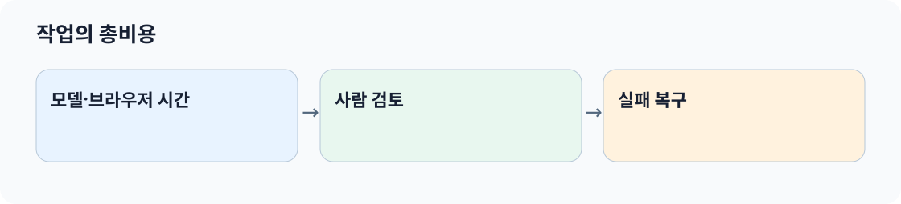

# 17. 비용·속도·데이터 관리

AI 브라우저의 비용은 모델 호출료만이 아닙니다. 화면을 반복해서 읽는 시간, 브라우저 실행 시간, 프록시·클라우드 비용, 사람이 검토하는 시간도 포함됩니다.

*그림: 이 장의 설명을 요약한 저자 제작 도식입니다. 실제 제품 화면이 아닙니다.*

## 비용을 줄이는 순서

1. 공개 페이지의 불필요한 반복 탐색을 줄입니다.
2. 한 번 읽은 결과를 기록하고 재사용합니다.
3. 짧은 작업에는 작은 모델을 사용합니다.
4. 실패 시 무한 재시도를 막습니다.
5. 외부 효과가 있는 작업은 자동 반복하지 않습니다.

## 데이터 보관 점검표

| 항목 | 확인 질문 |
|---|---|
| 스크린샷 | 개인정보가 포함되는가 |
| 브라우저 로그 | URL·쿠키·토큰이 남는가 |
| 프롬프트 | 내부 문서가 외부 모델로 전송되는가 |
| 다운로드 | 파일이 어느 폴더에 저장되는가 |
| 세션 | 작업 후 쿠키가 남아 있는가 |

속도가 빠른 에이전트가 항상 좋은 것은 아닙니다. 중요한 작업에서는 한 번 느리게 확인하는 것이 잘못된 전송을 되돌리는 것보다 쌉니다.

## 한 건당 비용을 적는 법

| 항목 | 기록할 단위 |
| --- | --- |
| 모델 사용 | 호출 또는 토큰 비용 |
| 브라우저 | 실행 시간과 인프라 요금 |
| 사람 | 검토·수정에 든 분 |
| 실패 | 재시도와 복구에 든 분 |

예를 들어 에이전트가 1분 만에 표를 만들더라도 사람이 20분간 출처를 고치면 전체 효율은 낮을 수 있습니다. 작업 유형별로 성공률과 총 소요 시간을 함께 보세요. 개인정보가 담긴 스크린샷은 불필요하게 오래 보관하지 않고, 보관 목적·담당자·삭제 시점을 기록합니다. 실제 요금은 도구와 계약에 따라 달라지므로 이 장은 금액표 대신 계산 항목을 제시합니다.
