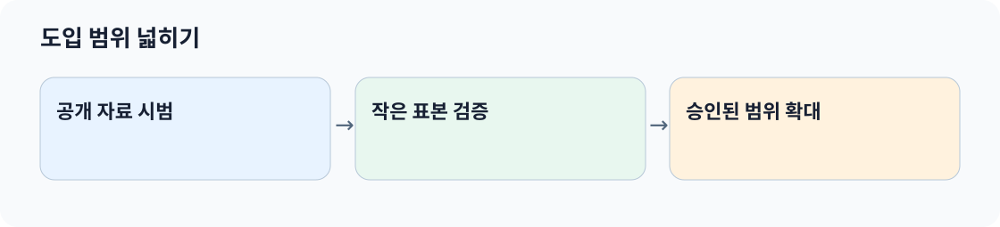

# 18. 실제 도입 체크리스트

조직에 도입할 때는 도구 이름보다 **검증하기 쉬운 한 가지 업무**를 먼저 고릅니다. 처음부터 고객 계정이나 결제 화면을 맡기면 실패 원인과 피해 범위를 분리하기 어렵습니다. 공개 자료 읽기처럼 외부 상태를 바꾸지 않는 일로 시작하면 에이전트의 답과 원문을 비교할 수 있습니다.

*그림: 공개 자료로 시범을 시작하고 작은 표본을 검증한 뒤 승인된 범위에서 확대하는 순서입니다. 저자 제작 도식이며 실제 제품 화면이 아닙니다.*

## 작은 시험의 입력과 예상 출력

예를 들어 운영팀이 공개 공지 열 건의 변경 날짜를 모으는 업무를 고른다고 해 보겠습니다. 입력은 공식 공지 URL 열 개와 필요한 열(`제목·변경 날짜·원문 URL·확인일`)입니다. 에이전트는 표 초안만 만듭니다. 사람은 열 건의 원문을 모두 열어 날짜와 제목을 대조합니다. **열 건, 같은 업무, 동일한 규칙**으로 수동 작업 시간과 에이전트 사용 후 총 시간을 비교합니다. 아직 실험하지 않았다면 성공률·시간 절감률 칸은 비워 둡니다.

## 도입 순서

1. 공개 정보 읽기 업무를 하나 선택합니다.
2. 성공·실패·멈춤 조건을 문서화합니다.
3. 계정이 필요 없는 공개 자료라면 로그인 없이 진행합니다. 계정이 필요한 다음 단계에서만 테스트 계정과 별도 환경을 만듭니다.
4. 같은 유형의 작은 표본을 여러 번 실행합니다.
5. 결과 증거와 로그를 검토합니다.
6. 위험이 낮은 범위에서만 자동화를 확대합니다.

## 도입 전 질문

- 에이전트가 읽을 수 있는 데이터는 무엇인가?
- 외부 상태를 바꿀 수 있는 행동은 무엇인가?
- 사람이 승인해야 하는 마지막 단계는 어디인가?
- 실패했을 때 누가 복구하는가?
- 로그와 스크린샷의 보관 기간은 얼마인가?
- 서비스 약관과 개인정보 정책을 확인했는가?

## 시험 기록표

| 항목 | 입력하거나 확인할 값 |
| --- | --- |
| 범위 | 허용한 도메인과 읽기 전용 행동 |
| 표본 | 공지 URL 열 개, 선정 이유, 확인일 |
| 예상 결과 | 제목·변경 날짜·원문 URL·확인일 표 |
| 실측 결과 | 원문과 일치한 건수, 누락·오류·멈춤 건수 |
| 전체 시간 | 에이전트 실행 + 사람 대조·수정 + 재시도 분 |
| 결론 | 그대로 유지 / 수정 후 재시험 / 중단 |

‘열 건’은 입문용 **시험 설계 예시**이며 통계적으로 충분한 표본이라는 뜻은 아닙니다. 한두 번 잘됐다고 고객 발송이나 계정 변경으로 확대하지 않습니다. 다음 업무로 넘어갈 때는 그 업무의 권한과 실패 비용에 맞는 별도 통과 기준을 정합니다.

## 중단 기준

같은 오류가 반복되거나, 에이전트가 승인 범위를 벗어나거나, 결과를 사람이 검증할 수 없으면 도입을 멈춥니다. 투자한 시간이 아깝다는 이유로 위험한 자동화를 계속하지 않습니다.

## 확대 전 통과해야 할 문

| 확인 문 | 통과 증거 |
| --- | --- |
| 정확성 | 표본의 원문 대조 기록 |
| 권한 | 예상 밖 도메인·계정 접근 없음 |
| 중단 | 실패 시 외부 효과를 확인하고 멈춤 |
| 운영 | 담당자·로그 보관·복구 경로 지정 |

한 단계가 실패하면 자동화 범위를 넓히지 말고 원인을 고칩니다. 예를 들어 공개 자료 조사에서 잘못된 원문을 반복 인용한다면 계정 연결이나 고객 발송으로 넘어갈 근거가 없습니다. 특히 허용하지 않은 도메인·개인정보·결제에 접근했다면 원인을 찾기 전까지 운영을 중단합니다. 도입 계획은 일정표보다 **검증 가능한 통과 조건**으로 관리하는 편이 분명합니다.
