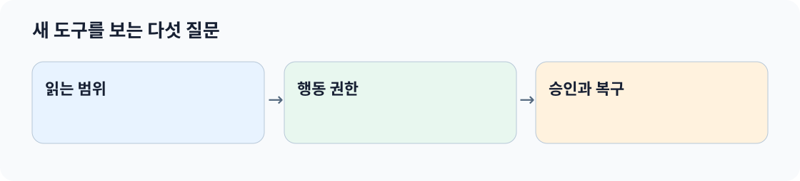

# 19. 브라우저 밖의 컴퓨터 화면을 다루는 AI

> 공식 자료 확인일: 2026-11-27. 아래 행사 예산 파일은 교육용 가상 사례입니다. 이 장을 쓰면서 데스크톱 에이전트를 실행하거나 파일을 수정하지 않았습니다.

앞 장들에서는 주로 웹페이지를 읽고 링크와 양식을 다뤘습니다. 그러나 실무자는 브라우저 밖에서도 일합니다. 내려받은 일정표를 열고, 메모장에 의견을 적고, 파일을 다른 이름으로 저장합니다. 이때 AI가 화면을 보고 마우스·키보드로 행동한다면 **현재 창, 파일, 저장 위치**까지 작업의 일부가 됩니다. 어느 앱을 조작하는지부터 확인해야 하는 이유입니다.



*그림: 활성 앱과 파일을 확인하고, 모델의 요청과 실행기의 조작을 구분한 뒤 파일 변경 승인과 다시 열어 보기를 이어 줍니다. 저자 제작 도식이며 실제 제품 화면이 아닙니다.*

## 웹페이지에서 벗어나면 무엇이 달라질까

| 같은 업무 | 브라우저 안 | 데스크톱 화면 |
| --- | --- | --- |
| 대상을 찾기 | 주소와 페이지 제목, 링크·입력창 | 앱 이름, 활성 창, 파일명과 저장 경로 |
| 다음 행동 | 페이지 요소를 클릭하거나 입력 | 창 전환, 파일 열기, 키보드 단축키, 저장 대화상자 조작 |
| 뜻밖의 정보 | 다른 탭의 계정·자료 | 바탕화면 파일, 알림, 최근 문서, 클립보드 내용 |
| 완료 확인 | 접수 화면·사이트의 저장 목록 | 실제 파일의 위치·수정 시각·다시 열어 본 내용 |

브라우저에도 파일 업로드와 여러 탭이 있지만, 데스크톱에서는 **앱 사이를 건너는 행동**이 더 자주 필요합니다. 파일 선택 창에서 같은 이름의 다른 파일을 고르거나, 팝업 때문에 입력 대상이 바뀔 수 있습니다. 화면 좌표를 기억한 채 클릭을 반복하는 방식은 이런 변화에 약합니다. 매 행동 뒤 새 화면과 활성 창을 다시 확인해야 합니다.

## 모델의 요청과 실행기의 행동

[Anthropic의 Computer Use 도구](https://platform.claude.com/docs/en/agents-and-tools/tool-use/computer-use-tool)는 스크린샷, 마우스, 키보드 호출을 모델이 요청하고 **개발자 애플리케이션이 준비한 환경에서 실제로 실행**하는 클라이언트 도구입니다. [Microsoft의 Windows 365 예제](https://learn.microsoft.com/en-us/samples/microsoft/agent365-samples/w365-computer-use-sample/)는 클라우드 PC 화면을 모델에 돌려주고, 별도의 도구가 클릭·입력·스크롤을 수행하는 예시입니다. 두 자료는 구조를 설명하지만, 독자가 자신의 노트북에서 즉시 쓸 수 있는 동일한 완성형 앱을 약속하지 않습니다.

```text
작업 목표 → 현재 화면 캡처 → 모델의 행동 요청 → 실행기의 실제 조작
         ← 바뀐 화면 캡처 ← 결과 확인 또는 사람에게 인계
```

예를 들어 모델이 “일정표를 저장하라”고 요청한 것과 파일이 실제로 저장된 것은 다릅니다. 실행기가 저장 대화상자를 열었는지, 새 파일 이름을 입력했는지, 다른 앱의 창이 앞에 있지 않은지, 파일이 열리는지까지 확인해야 합니다. 한 번에 여러 행동을 묶을 수 있는 구현도 있지만, 창 전환과 외부 변경을 사이에 두고 관찰 없이 계속 진행하면 잘못된 대상에 쓰기 쉽습니다.

## 관통 사례: 행사 예산표에서 숫자 두 개 대조하기

7~13장에서 장소를 비교한 30명 교육 행사를 떠올려 봅시다. 담당자는 데스크톱에 `행사-예산-연습.txt`라는 **가상 연습 파일**을 열어 두었습니다. 내용은 `장소 대관료 300000원`, `식비 150000원` 두 줄뿐입니다. 에이전트에게 두 금액을 읽고 합계를 **초안으로만 제시**하게 한다면, 실제 파일 변경 없이 화면 관찰과 계산 검증을 연습할 수 있습니다.

| 단계 | 화면에서 확인할 것 | 허용할 행동 | 멈출 조건 |
| --- | --- | --- | --- |
| 시작 | 연습 파일명, 활성 앱, 다른 개인 파일·알림 노출 여부 | 해당 파일 읽기 | 다른 문서나 계정 창이 앞에 있음 |
| 관찰 | 두 금액과 단위가 화면에 모두 보이는지 | 필요한 범위만 다시 보기 | 일부 행이 가려져 숫자가 불완전함 |
| 계산 | 읽은 값 `300000 + 150000` | 합계 초안 제시 | 원문에 없는 비용을 추측함 |
| 결과 | 사람이 원본과 초안을 대조 | `450000원`을 **예상 합계**로 기록 | 파일을 덮어쓰거나 외부로 전송하려 함 |

이 표의 합계는 교육용 입력을 사람이 계산한 **기대값**입니다. 에이전트 실측 결과가 아닙니다. 실제 업무에서는 셀의 수식·세금·중복 항목이 있을 수 있으므로, 숫자가 두 개 보였다는 이유만으로 견적서 전체가 검증됐다고 할 수 없습니다.

## 파일을 바꾸는 순간의 승인과 증거

연습을 파일 편집까지 넓힌다면 “저장”을 별도 행동으로 다룹니다. 원본을 덮어쓰지 않고 `행사-예산-검토본.txt`처럼 새 이름으로 저장할지 먼저 정합니다. 저장 위치, 바뀔 내용, 원본 보존 여부, 공유 대상이 있다면 그 범위를 사람에게 보여 준 뒤 승인받습니다. 저장 버튼을 누른 뒤에는 목록에 새 파일이 있는지 확인하고 **다시 열어 내용**을 대조합니다. 제목 표시줄의 파일명만으로 완료를 확정하지 않습니다.

데스크톱에는 브라우저의 URL처럼 항상 같은 위치에 보이는 신원 표지가 없습니다. 활성 창이 바뀌거나 저장 대화상자가 뜨면, 이전 화면의 좌표와 단축키가 다른 효과를 낼 수 있습니다. 작업 기록에는 최소한 `시각·활성 앱·파일명·마지막 행동·새 화면·저장 여부`를 남깁니다. 비밀번호·알림 본문·개인 파일 내용이 기록 화면에 보이면 공유 전에 가립니다.

## 사람만으로 해 보는 안전한 관찰 연습

이 연습은 **컴퓨터 사용 AI를 실행하는 절차가 아닙니다**. 자신의 컴퓨터에서 권한과 완료 증거를 먼저 판단하는 훈련입니다.

1. 빈 텍스트 파일에 위 두 금액을 직접 입력하고 개인 정보가 없는 연습 폴더에 저장합니다.
2. 파일을 연 상태에서 앱 이름, 파일명, 화면에 보이는 두 값, 창 뒤의 알림 노출 여부를 기록합니다.
3. AI가 `합계 450000원`이라고 답했다고 **가정**하고 원본 숫자와 계산을 사람이 대조합니다.
4. AI가 원본 파일을 수정하거나 메일로 보내겠다고 하면, 그 행동에 필요한 승인 카드의 `대상·변경 내용·저장 위치·되돌림 방법`을 적어 봅니다. 실제 전송은 하지 않습니다.
5. 연습 파일을 닫고, 기록에 개인 파일명이나 알림이 들어가지 않았는지 확인합니다.

실제 데스크톱 에이전트를 구축하거나 사용할 때에는 [Anthropic의 보안 안내](https://platform.claude.com/docs/en/agents-and-tools/tool-use/computer-use-tool)의 격리 환경·최소 권한·민감정보 제한과 사람의 중요 행동 확인을 먼저 검토합니다. 클라우드 PC 예시는 [Microsoft의 샘플](https://learn.microsoft.com/en-us/samples/microsoft/agent365-samples/w365-computer-use-sample/)을 통해 구조를 읽을 수 있지만, 이 책은 해당 샘플의 실행·성능을 검증하지 않았습니다. 데스크톱 조작의 목표도 결국 **올바른 창에서 올바른 파일을 바꾸고, 결과를 다시 확인하는 것**입니다.
