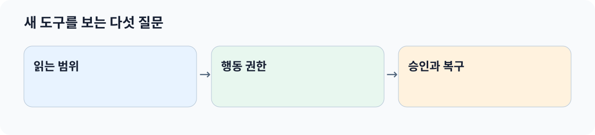

# 19. AI가 읽는 웹의 미래

AI 브라우저가 널리 사용되면 웹페이지는 사람뿐 아니라 에이전트도 읽기 쉬워야 합니다. 명확한 구조, 접근성 이름, 기계가 확인할 수 있는 상태, 에이전트가 지켜야 할 권한 경계가 중요해집니다.

*그림: 이 장의 설명을 요약한 저자 제작 도식입니다. 실제 제품 화면이 아닙니다.*

## 앞으로의 변화

| 변화 | 기대 효과 | 남는 질문 |
|---|---|---|
| 에이전트 친화적 웹 구조 | 탐색 오류 감소 | 누가 구조를 표준화하는가 |
| 브라우저 내 승인 UI | 위험 행동 통제 | 사용자가 내용을 이해하고 승인하는가 |
| 에이전트 신원 표시 | 봇과 사람 구분 | 개인정보와 추적의 균형은 무엇인가 |
| 실행 기록 표준화 | 사고 조사와 재현 | 로그를 누가 보관하는가 |
| 여러 에이전트 협업 | 긴 업무 분담 | 책임 주체를 어떻게 정하는가 |

AI가 웹을 읽는다고 해서 웹이 자동으로 신뢰할 수 있는 공간이 되는 것은 아닙니다. 오히려 에이전트가 읽는 문장과 에이전트에게 허용된 행동을 더 엄격히 구분해야 합니다.

## 이 책을 읽은 뒤의 기준

새로운 AI 브라우저가 등장하면 “얼마나 똑똑한가”만 묻지 마세요.

1. 무엇을 볼 수 있는가?
2. 무엇을 바꿀 수 있는가?
3. 언제 사람에게 묻는가?
4. 실패를 어떻게 증명하고 복구하는가?
5. 데이터와 세션은 어디에 남는가?

이 다섯 질문에 답할 수 있다면 새로운 도구의 이름이 바뀌어도 안전하게 평가할 수 있습니다.

## 미래 전망을 제품 선택으로 바꾸기

새 도구가 “더 자율적”이라고 소개될 때는 시연 영상보다 업무 경계를 먼저 확인하세요. 어떤 페이지를 읽을 수 있는지, 로그인된 계정에서 무엇을 바꿀 수 있는지, 사람의 거부를 어떻게 처리하는지 문서로 확인합니다.

| 소개 문구 | 확인할 자료 |
| --- | --- |
| “실제 브라우저 사용” | 지원 브라우저·프로필 범위 |
| “끝까지 처리” | 완료 증거와 실패 상태 |
| “안전한 자동화” | 승인·로그·데이터 보관 정책 |

접근성 이름과 구조화된 상태가 좋아져도 웹페이지의 문장이 사용자 명령으로 바뀌지는 않습니다. 웹의 형태가 변해도 **외부 자료의 신뢰 경계**와 **결과 확인**은 책의 중심 기준으로 남습니다.
