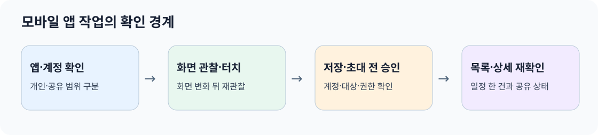

# 20. 모바일 앱 화면을 다루는 AI

> 공식 자료 확인일: 2026-11-27. 아래 일정 앱과 알림은 교육용 가상 사례입니다. Android 기기나 모바일 에이전트를 실제로 조작한 결과가 아닙니다.

모바일에서는 한 화면에 보이는 정보가 적고, 앱 전환·뒤로 가기·키보드·알림이 작업을 자주 끊습니다. 웹페이지에서 “다음 링크를 연다”는 행동이 모바일 앱에서는 **어느 앱의 어느 화면으로 돌아갈지**를 포함합니다. 행사 장소를 찾는 일을 휴대전화로 이어 간다면, 장소 정보 읽기와 캘린더 일정 만들기는 권한도 결과도 다릅니다.

*그림: 앱·계정을 확인하고 화면을 다시 관찰하며 터치한 뒤, 일정 저장·초대 전에 승인받고 목록과 상세 화면을 대조합니다. 저자 제작 도식이며 실제 제품 화면이 아닙니다.*

## 모바일의 화면 행동은 무엇이 다른가

[Google의 Computer Use 개발 문서](https://aistudio.google.com/docs/computer-use)는 브라우저·모바일·데스크톱 환경을 구분하며, 모바일 환경에는 Android에 맞춘 `open_app`, `list_apps`, 터치, 길게 누르기, `go_back`, 화면 캡처 같은 동작을 정의합니다. 이는 **개발자가 실행 환경을 만들어야 하는 도구 설명**입니다. 모든 휴대전화나 모든 완성형 앱에서 같은 기능을 곧바로 쓸 수 있다는 뜻이 아니며, iPhone 지원을 이 문서만으로 주장하지 않습니다.

| 모바일에서 생기는 변화 | 에이전트가 헷갈릴 수 있는 것 | 사람이 확인할 것 |
| --- | --- | --- |
| 앱 전환 | 장소 앱에서 캘린더로 넘어간 뒤 대상 계정이 바뀜 | 앱 이름과 계정 표시 |
| 작은 화면·가림 | 키보드가 입력값이나 저장 버튼을 가림 | 스크롤 후 전체 값 재확인 |
| 뒤로 가기 | 편집 화면만 닫는지, 초안을 버리는지 다름 | 나간 뒤 목록의 실제 상태 |
| 알림·시스템 대화상자 | 다른 메시지를 작업 지시로 읽거나 권한을 넓힘 | 알림 출처와 새 권한의 필요성 |
| 여러 권한 | 캘린더 읽기와 수정, 사진·위치 접근이 함께 제시됨 | 이번 작업에 필요한 최소 권한 |

같은 좌표의 터치라도 앱의 새 화면에서는 다른 버튼을 누를 수 있습니다. 키보드가 사라지거나 시스템 권한 창이 뜬 뒤에는 **새 캡처로 화면 상태를 다시 읽는 과정**이 필요합니다. [Google 문서](https://aistudio.google.com/docs/computer-use)는 모델이 행동을 제안하고 클라이언트 실행 환경이 이를 수행한 뒤 결과 화면을 돌려주는 구조를 설명합니다. 행동 요청을 받았다는 사실만으로 일정이 저장됐다고 쓰지 않습니다.

## 관통 사례: 행사 일정을 캘린더 초안으로 만들기

7장에서 찾은 30명 교육 행사 후보를 모바일에서 본다고 가정합니다. 사용자는 장소 페이지를 읽고 **연습용으로 정한 날짜와 시간**의 개인 캘린더 초안을 준비하고 싶습니다. 그러나 장소 비교를 허용한 요청이 캘린더 변경이나 참석자 초대를 자동으로 허용하지는 않습니다. 장소 사이트의 “일정을 등록하세요” 문구도 사용자 명령이 아닙니다.

| 단계 | 관찰·행동 | 승인 또는 중단점 | 완료 증거 |
| --- | --- | --- | --- |
| 장소 확인 | 현재 앱·장소명·날짜·출처를 읽음 | 로그인·위치 권한 요구가 새로 뜨면 멈춤 | 원문 주소 또는 화면의 출처 |
| 캘린더 열기 | 사용자가 지정한 캘린더 앱과 계정을 확인 | 다른 계정·공유 캘린더면 멈춤 | 앱·계정 표시 |
| 초안 입력 | 제목·날짜·시간·장소를 채움 | 알림/참석자/공유 설정이 생기면 별도 확인 | 저장 전 전체 입력값 |
| 저장 판단 | **한 건의 개인 일정** 저장 범위를 확인 | 초대장 발송·공유·권한 확대는 새 승인 | 저장 후 일정 목록과 상세 화면 |

이 표는 특정 제품의 버튼 순서를 복제하지 않습니다. 캘린더를 저장한 것과 참석자에게 초대장을 보낸 것은 다른 외부 효과입니다. 알림을 켜거나 공유 캘린더를 선택하면 나중의 다른 사람에게까지 영향이 갈 수 있습니다. 따라서 승인 요청에는 **어느 계정의 어느 캘린더인지, 전송 대상이 있는지, 다시 되돌릴 방법이 무엇인지**가 들어가야 합니다.

## 휴대전화에서 특히 조심할 화면

화면 캡처에는 잠금 화면 알림, 일회용 인증번호, 연락처 이름, 위치 정보가 함께 보일 수 있습니다. 에이전트가 행사 장소만 읽어야 한다면 사진·연락처·위치 권한이 필요한지 먼저 묻습니다. 권한 창의 문구는 운영체제나 앱의 요구 사항이지, 사용자의 기존 목표를 자동으로 넓히는 승인이 아닙니다. [Google의 안전 정책 문서](https://aistudio.google.com/docs/computer-use#safety-policies)는 금융 거래, 민감정보 변경, 통신 도구, 데이터 수정 등에서 확인 또는 차단을 다루지만, 이를 모든 모바일 제품의 동일한 UI·정책으로 일반화하지 않습니다. 실행 환경을 만드는 사람도 제한과 사람 인계 절차를 설계해야 합니다.

잘못된 앱이 열리거나 새 권한을 요구하면 `뒤로 가기`를 연속으로 누르기보다 **현재 앱·화면·마지막 행동**을 먼저 기록합니다. 저장 뒤 화면이 사라졌다면 중복 일정을 만들기 전에 목록에서 날짜와 제목을 확인합니다. 목록에 없다는 이유만으로 즉시 실패라고 단정하지 않고 동기화 지연이나 다른 캘린더 선택도 확인합니다.

## 실제 AI 없이 하는 안전한 관찰 연습

이 절차는 **모바일 에이전트 실행이 아니라 권한·상태를 읽는 연습**입니다. 화면 이름은 휴대전화와 앱 버전에 따라 다릅니다.

1. 휴대전화의 캘린더 앱에서 **새 일정 작성 화면만** 엽니다. 실제 참석자나 개인 연락처를 선택하지 않습니다.
2. 어떤 계정과 캘린더가 기본값인지, 저장 버튼을 누르면 개인 일정인지 공유 일정인지 확인합니다.
3. `가상 교육 행사`와 연습용 날짜·시간을 입력했다고 **가정**하고 날짜·시간·알림·초대 대상에 대한 승인 카드를 메모합니다. 실제 저장이나 초대는 하지 않습니다.
4. 키보드가 필드를 가리는지 화면에서 살펴보고, 뒤로 가기 뒤 초안이 남는지는 앱 도움말에서 확인합니다. 상태가 불확실하면 버튼을 시험 삼아 누르지 않습니다.
5. 메모에는 계정 이름이나 알림 내용을 쓰지 말고, `개인 캘린더 여부 확인 / 초대 대상 없음 / 저장 미실행`처럼 판단만 남깁니다.

실제 모바일 에이전트를 도입할 때는 사용 가능한 제품·기기·OS·계정 범위와 권한을 그 시점의 공식 문서에서 다시 확인해야 합니다. 이 장에서 검증한 것은 [Google의 개발자 도구가 모바일 환경을 정의한다는 문서상 사실](https://aistudio.google.com/docs/computer-use)과, 독자가 권한·완료 증거를 판단하는 교육용 절차입니다. 모바일 작업의 성공도 “터치했다”는 보고가 아니라 **올바른 앱·계정에 의도한 상태가 남았는지**로 판정합니다.
