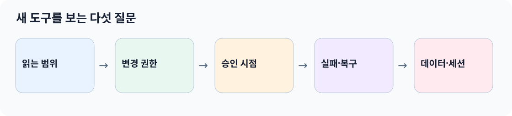

# 21. AI가 읽는 화면의 미래

화면을 읽고 행동하는 AI가 늘어나면 웹페이지와 데스크톱 앱은 어떤 모습이어야 할까요? 이 장은 2026년 11월 27일 현재 제품 문서에서 **이미 확인되는 설계**와 그로부터 생각해 볼 **전망**을 구분합니다. 미래의 표준이나 시장 점유율이 확정됐다는 뜻은 아닙니다.

*그림: 새 도구의 읽기 범위, 변경 권한, 승인 시점, 실패·복구, 데이터·세션을 확인할 다섯 질문입니다. 저자 제작 도식이며 실제 제품 화면이 아닙니다.*

## 지금 확인할 수 있는 것

[OpenAI computer use 문서](https://developers.openai.com/api/docs/guides/tools-computer-use)는 모델의 행동 요청과 개발자 실행기의 실제 수행·새 화면 전달을 나누어 설명합니다. [Anthropic browser use 문서](https://platform.claude.com/docs/en/agents-and-tools/tool-use/browser-use-tool)는 웹페이지를 읽고 조작하는 별도 도구를 설명합니다. [Microsoft Foundry browser automation 문서](https://learn.microsoft.com/en-us/azure/foundry/agents/how-to/tools/browser-automation)는 원격 브라우저의 페이지 요소 기반 조작과 사람의 개입을 다룹니다. 구현은 서로 다르지만, 어느 경우든 **관찰한 화면과 실제 행동, 승인과 결과 확인을 구분해야 한다**는 편집상 결론을 얻을 수 있습니다.

## 앞으로 검증할 변화

| 변화 | 기대 효과 | 남는 질문 |
|---|---|---|
| 에이전트가 읽기 쉬운 웹 구조 | 탐색 오류가 줄 수 있음 | 접근성 개선과 에이전트 성능 사이에 실제 근거가 있는가 |
| 더 분명한 승인 화면 | 사용자가 결과를 확인하기 쉬워질 수 있음 | 승인 요청이 너무 잦아지지 않는가 |
| 에이전트 신원 표시 | 사이트의 정책 적용에 도움을 줄 수 있음 | 개인정보와 추적의 균형을 어떻게 맞추는가 |
| 실행 기록 형식 | 사고 조사와 재현에 도움을 줄 수 있음 | 민감한 화면·입력값을 누가 얼마나 보관하는가 |
| 여러 에이전트 협업 | 긴 업무를 나눌 수 있음 | 최종 결과와 외부 행동의 책임은 누가 지는가 |

표의 기대 효과는 **검증할 가설**입니다. AI가 웹을 읽는다고 해서 웹이 자동으로 신뢰할 수 있는 공간이 되는 것은 아닙니다. 에이전트가 읽는 문장과 에이전트에게 허용된 행동을 계속 구분해야 합니다.

## 이 책을 읽은 뒤의 기준

새로운 AI 브라우저가 등장하면 “얼마나 똑똑한가”만 묻지 마세요.

1. 무엇을 볼 수 있는가?
2. 무엇을 바꿀 수 있는가?
3. 언제 사람에게 묻는가?
4. 실패를 어떻게 증명하고 복구하는가?
5. 데이터와 세션은 어디에 남는가?

이 다섯 질문에 답할 수 있다면 새로운 도구의 이름이 바뀌어도 안전하게 평가할 수 있습니다.

## 미래 전망을 제품 선택으로 바꾸기

새 도구가 “더 자율적”이라고 소개될 때는 시연 영상보다 업무 경계를 먼저 확인하세요. 어떤 페이지를 읽을 수 있는지, 로그인된 계정에서 무엇을 바꿀 수 있는지, 사람의 거부를 어떻게 처리하는지 문서로 확인합니다.

| 소개 문구 | 확인할 자료 |
| --- | --- |
| “실제 브라우저 사용” | 지원 브라우저·프로필 범위 |
| “끝까지 처리” | 완료 증거와 실패 상태 |
| “안전한 자동화” | 승인·로그·데이터 보관 정책 |

접근성 이름과 구조화된 상태가 좋아져도 웹페이지의 문장이 사용자 명령으로 바뀌지는 않습니다. 웹의 형태가 변해도 **외부 자료의 신뢰 경계**와 **결과 확인**은 책의 중심 기준으로 남습니다. 이 책을 마친 독자는 새 제품을 볼 때 기능 목록과 함께 실제 업무의 입력, 승인 지점, 완료 증거를 물어볼 수 있어야 합니다.
